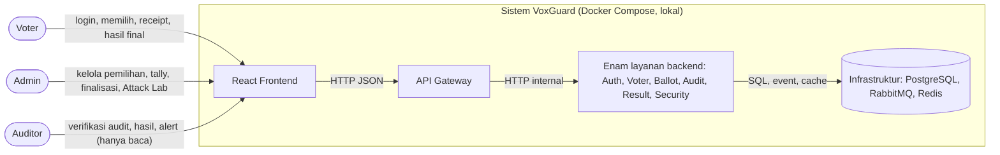
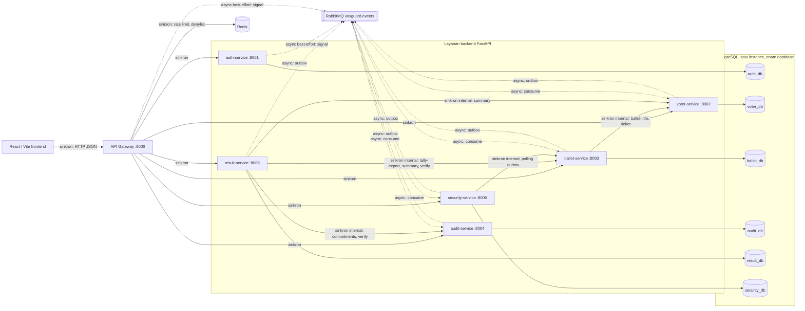
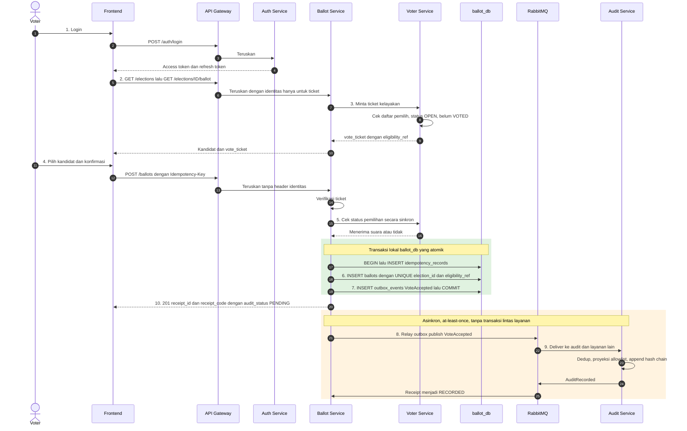
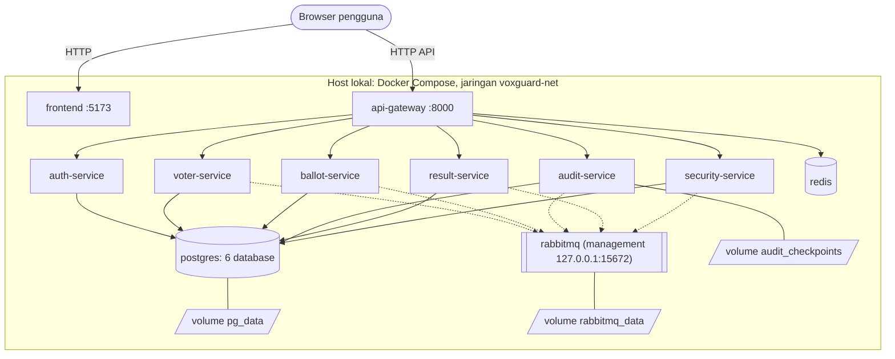

# VoxGuard — System Architecture Document (SAD)

## 1. Document Information

| Atribut | Nilai |
|---|---|
| Nama dokumen | System Architecture Document |
| Proyek | VoxGuard — Verifiable Digital Election System |
| Versi / Status | 0.1 / **Draft — usulan arsitektur, belum disetujui** |
| Tanggal | 2026-10-10 |
| Pemilik | `[PEMILIK-DOKUMEN]` (placeholder; lihat legenda di `01_PROJECT_CHARTER.md`) |
| Acuan | Terinspirasi arc42 dan C4 Model; **tidak** mengklaim kepatuhan formal |

| Versi | Tanggal | Perubahan |
|---|---|---|
| 0.1 | 2026-10-10 | Draf awal |

Dokumen terkait: `01_PROJECT_CHARTER.md`, `02_SOFTWARE_REQUIREMENTS_SPECIFICATION.md` (SRS). Dokumen pendamping lama di repository (**tidak diubah**, konsisten dengan dokumen ini): `ARCHITECTURE.md` (skema kolom lengkap, SQL, Compose, diagram alur tambahan), `API_CONTRACTS.md` (skema endpoint dan payload event), `SECURITY_AND_TEST_PLAN.md` (threat matrix, Attack Lab, rencana uji), `PROJECT_BRIEF.md`. SAD merujuk ke dokumen tersebut untuk detail agar tidak duplikasi (lihat OD-14). **Semua mekanisme berstatus direncanakan**; repository belum berisi kode dan belum ada hasil pengujian.

---

## 2. Architecture Overview

**Gaya:** microservices dengan satu API Gateway, komunikasi sinkron REST/JSON untuk permintaan pengguna dan validasi kritis, dan asinkron berbasis event (RabbitMQ) untuk audit, keamanan, dan sinkronisasi status. Database per layanan (logis).

**Alasan microservices.** (1) Tujuan proyek mencakup mendemonstrasikan komunikasi antarmicroservice; (2) pemisahan data sensitif — identitas (`auth_db`), kelayakan (`voter_db`), isi suara (`ballot_db`), audit (`audit_db`), hasil (`result_db`) — menyulitkan satu kompromi komponen membuka seluruh data; (3) pemisahan hak database (mis. `ballot_app` hanya `INSERT/SELECT` pada suara).

**Trade-off terhadap monolith.** Monolith modular akan lebih murah dibangun, di-*debug*, dan di-*deploy*, serta mengizinkan transaksi tunggal lintas modul. Microservices menambah biaya: kontrak antarlayanan, konsistensi eventual, outbox/idempotensi, observability terdistribusi, orkestrasi Compose, dan *debugging* lintas proses. Jumlah layanan dibatasi (enam + gateway) karena tim hanya 2–3 orang. Microservices tidak dianggap selalu lebih unggul; pilihan ini diusulkan karena tujuan akademik dan pemisahan data (ADR-01).

**Batasan arsitektur.** Satu mesin; satu instance PostgreSQL/RabbitMQ/Redis; tidak ada transaksi terdistribusi; tidak ada akses tabel lintas layanan; teknologi dibatasi stack yang ditetapkan.

**Satu bahasa backend (Python/FastAPI).** Menyederhanakan onboarding, berbagi pustaka non-domain (`voxguard_common`: format error, middleware request ID, envelope event, canonical JSON, utilitas hash), dan pengujian dengan Pytest/HTTPX. Konsekuensi: tidak ada isolasi bahasa; kegagalan pustaka bersama berdampak ke semua layanan — pustaka dijaga kecil dan bebas logika domain.

---

## 3. Architecture Drivers

| Driver | Sumber (SRS) | Konsekuensi arsitektur |
|---|---|---|
| Pencegahan suara ganda | BR-001, FR-BALL-003/004/005 | Konsumsi hak di `ballot_db` dengan unique constraint + transaksi + idempotency |
| Keamanan | NFR-SEC-001..009 | Gateway + RBAC ganda, role DB minimum, jaringan internal |
| Pemisahan data | BR-007, NFR-PRV-001/002 | Vote ticket berpseudonim; Ballot tanpa `user_id`; allowlist event |
| Integritas audit | FR-AUDT-001..006 | Hash chain per scope + checkpoint |
| Konsistensi hasil | FR-RSLT-001..005, NFR-REL-005 | Tally dari ekspor Ballot + rekonsiliasi tiga arah + commitment |
| Reliability event | NFR-REL-001..006, FR-SYSO-005 | Outbox, idempotent consumer, retry, DLQ |
| Demonstrasi akademik | OBJ-05, OBJ-06 | Attack Lab terkunci, metrik dan alert jelas |
| Tim kecil | AS-02 | Enam layanan, satu bahasa, hindari overengineering |

---

## 4. System Context Diagram

Tidak ada sistem eksternal. Semua aktor mengakses sistem melalui frontend dan gateway.

---

## 5. Container Diagram

Panah penuh = sinkron; putus-putus = asinkron. Satu gateway + enam layanan = tujuh komponen backend. Tidak ada panah antar-database.

---

## 6. Service Responsibility Matrix

Daftar endpoint lengkap: `API_CONTRACTS.md` B; kolom Requirement memetakan SRS ke komponen (aturan 6.4).

| Layanan | Tanggung jawab | Kapabilitas utama | Data dimiliki | Event terbit | Event konsumsi | Dependency | Batas keamanan | Pemilik (usulan) | Requirement |
|---|---|---|---|---|---|---|---|---|---|
| **api-gateway** | Routing, request/correlation ID, rate limit, verifikasi JWT, penerusan header identitas, validasi awal. **Bukan** logika bisnis | `/api/v1/*`, health | Redis (`rl:*`, `deny:jti:*`) | `SecuritySignalObserved` (best-effort) | — | Semua layanan, Redis, RabbitMQ | Membuang header identitas dari klien; tidak meneruskan identitas ke `POST /ballots` | `[ANGGOTA-1]` | FR-SYSO-003/007, FR-AUTH-006 |
| **auth-service** | Akun, kredensial, sesi, RBAC claim | register, login, refresh, logout, me | `auth_db`: `users`, `refresh_sessions` | `SecuritySignalObserved` (best-effort) | — | Redis, RabbitMQ | Tidak mengenal pemilihan/suara; Argon2id | `[ANGGOTA-1]` | FR-AUTH-001..007 |
| **voter-service** | Pemilihan, kandidat, pemilih, kelayakan, lifecycle, ticket | `/elections*`, endpoint internal | `voter_db`: `elections`, `candidates`, `voters`, `voting_eligibility`, outbox | `ElectionOpened`, `ElectionClosed` | `VoteAccepted`, `ResultFinalized` | RabbitMQ | Tidak menyimpan pilihan; satu-satunya pemegang `ELIGIBILITY_PEPPER` | `[ANGGOTA-1]` | FR-ELEC-*, FR-ELIG-* |
| **ballot-service** | Menerima suara; anti-ganda; idempotency; receipt; outbox | `GET …/ballot`, `POST /ballots`, receipt, ekspor internal | `ballot_db`: `ballots`, `idempotency_records`, `outbox_events`, `election_gates`, `audit_acks` | `VoteAccepted`, `VoteRejected` | `ElectionOpened/Closed`, `AuditRecorded` | voter-service (sinkron), Redis, RabbitMQ | Tanpa `user_id`; `ballots` append-only; fail-closed | `[ANGGOTA-1]` (2 org) / `[ANGGOTA-2]` (3 org) | FR-BALL-001..008 |
| **audit-service** | Hash chain, verifikasi, proof, checkpoint | `/audit/*`, endpoint internal | `audit_db`: `audit_events`, `audit_chain_heads`, `audit_checkpoints`, `integrity_checks`, outbox | `AuditRecorded`, `SecuritySignalObserved` | `ElectionOpened/Closed`, `VoteAccepted`, `TallyCompleted`, `ResultFinalized`, `SecurityAlertRaised` | RabbitMQ, volume checkpoint | Allowlist payload; tanpa edit/hapus; endpoint uji terkunci | `[ANGGOTA-2]` | FR-AUDT-* |
| **result-service** | Tally, rekonsiliasi, finalisasi, verifikasi hasil | `/results/*` | `result_db`: `tally_runs`, `tally_items`, `final_results`, outbox | `TallyCompleted`, `ResultFinalized` | — | ballot, audit, voter (sinkron), RabbitMQ | Tidak menerima suara; `final_results` append-only | `[ANGGOTA-2]` (2 org) / `[ANGGOTA-3]` (3 org) | FR-RSLT-* |
| **security-service** | Deteksi anomali, alert, metrik, Attack Lab | `/security/*` | `security_db`: `security_events`, `anomaly_alerts`, `attack_runs`, outbox | `SecurityAlertRaised` | `ElectionOpened/Closed`, `VoteAccepted/Rejected`, `AuditRecorded`, `TallyCompleted`, `SecuritySignalObserved` | RabbitMQ (+ management API), ballot (polling) | Mendeteksi, tidak memblokir; Lab terkunci | `[ANGGOTA-2]` (2 org) / `[ANGGOTA-3]` (3 org) | FR-SECM-* |
| **frontend** | UI per role | Halaman Voter/Admin/Auditor | — | — | — | Gateway | Tidak menyimpan token di luar mekanisme yang ditetapkan (OD-21) | `[ANGGOTA-2]` / `[ANGGOTA-3]` | FR-UI-* |

---

## 7. Service Boundary and Database Ownership

### 7.1 Kepemilikan data

| Database | Layanan pemilik | Tabel |
|---|---|---|
| `auth_db` | auth-service | `users`, `refresh_sessions` |
| `voter_db` | voter-service | `elections`, `candidates`, `voters`, `voting_eligibility`, `outbox_events`, `processed_events` |
| `ballot_db` | ballot-service | `ballots`, `idempotency_records`, `outbox_events`, `election_gates`, `audit_acks`, `processed_events` |
| `audit_db` | audit-service | `audit_events`, `audit_chain_heads`, `audit_checkpoints`, `integrity_checks`, `outbox_events`, `processed_events` |
| `result_db` | result-service | `tally_runs`, `tally_items`, `final_results`, `outbox_events` |
| `security_db` | security-service | `security_events`, `anomaly_alerts`, `attack_runs`, `outbox_events` |

Satu instance PostgreSQL dengan enam database dan enam role (`auth_app`, `voter_app`, `ballot_app`, `audit_app`, `result_app`, `security_app`); setiap role hanya mengakses database miliknya. **Tidak ada layanan yang membaca atau menulis tabel layanan lain.** Data lintas layanan diperoleh lewat API internal (sinkron) atau event (asinkron).

### 7.2 Konsekuensi konsistensi data lintas layanan

| Kebutuhan lintas layanan | Mekanisme | Konsekuensi |
|---|---|---|
| Status pemilihan saat memilih | Ballot → Voter (sinkron, tanpa cache status) | Konsisten kuat; Voter mati → voting berhenti (fail-closed) |
| Status `VOTED` di Voter | Event `VoteAccepted` | Eventual; hanya cermin untuk penolakan dini/statistik, bukan penjaga utama |
| Suara untuk tally | Result → Ballot (ekspor internal) | Konsisten pada saat tally; bergantung ketersediaan Ballot |
| Receipt `RECORDED` | Event `AuditRecorded` → `audit_acks` | Eventual; `PENDING` sampai diproses |
| `FINALIZED` di Voter | Event `ResultFinalized` | Eventual; sumber kebenaran hasil adalah Result |

### 7.3 Lifecycle pemilihan (acuan BR-003)

`DRAFT → SCHEDULED → OPEN → CLOSED → FINALIZED`. Pemilik state: voter-service. Status tambahan tidak diperlukan.

| Transisi | Pemicu | Berwenang | Guard | Efek |
|---|---|---|---|---|
| `DRAFT→SCHEDULED` | `POST /elections/{id}/schedule` (endpoint tambahan di `API_CONTRACTS.md`) | Admin | ≥ 2 kandidat, ≥ 1 pemilih, jadwal valid | Bekukan kandidat/pemilih; buat `voting_eligibility` |
| `SCHEDULED→OPEN` | `POST …/open` | Admin (otomatis: OD-02) | `now < end_at` | `ElectionOpened` |
| `OPEN→CLOSED` | `POST …/close` | Admin (otomatis: OD-02) | status `OPEN` | `closed_at`, `ElectionClosed`, checkpoint audit |
| `CLOSED→FINALIZED` | `POST /results/…/finalize` | Admin (dieksekusi Result; Voter menerapkan dari event) | tally `COMPLETED`+`MATCH`, audit `VALID` | `final_results`, `ResultFinalized` |

---

## 8. Data Model

### 8.1 ERD (relasi lokal per database; tidak ada garis lintas database)

```mermaid
erDiagram
    USERS ||--o{ REFRESH_SESSIONS : "has"
    USERS {
        uuid id PK
        text email UK
        text password_hash
        text role
        int failed_login_count
        timestamptz locked_until
    }
    REFRESH_SESSIONS {
        uuid id PK
        uuid user_id FK
        uuid family_id
        char64 token_hash UK
        timestamptz expires_at
        timestamptz revoked_at
    }

    ELECTIONS ||--o{ CANDIDATES : "has"
    ELECTIONS ||--o{ VOTERS : "lists"
    VOTERS ||--|| VOTING_ELIGIBILITY : "has"
    ELECTIONS {
        uuid id PK
        text status
        timestamptz start_at
        timestamptz end_at
        timestamptz closed_at
        bool is_attack_lab
    }
    CANDIDATES {
        uuid id PK
        uuid election_id FK
        text name UK
        int ballot_order UK
    }
    VOTERS {
        uuid id PK
        uuid election_id FK
        text email_normalized UK
        text external_ref UK
        uuid user_id
    }
    VOTING_ELIGIBILITY {
        uuid id PK
        uuid election_id
        uuid voter_id FK
        char64 eligibility_ref UK
        text status
    }

    BALLOTS {
        uuid id PK
        uuid election_id
        char64 eligibility_ref UK
        uuid candidate_id
        char64 ballot_nonce
        char64 ballot_commitment
        uuid receipt_id UK
        timestamptz accepted_at
    }
    IDEMPOTENCY_RECORDS {
        uuid id PK
        char64 eligibility_ref UK
        text idempotency_key UK
        char64 request_hash
        jsonb response_snapshot
    }
    OUTBOX_EVENTS {
        uuid id PK
        text event_type
        jsonb payload
        text status
        timestamptz next_attempt_at
    }

    AUDIT_EVENTS {
        uuid id PK
        uuid scope_id UK
        bigint sequence UK
        uuid source_event_id UK
        jsonb payload_public
        char64 prev_hash
        char64 event_hash
    }
    INTEGRITY_CHECKS {
        uuid id PK
        uuid scope_id
        text status
        bigint first_failure_sequence
    }

    TALLY_RUNS ||--o{ TALLY_ITEMS : "has"
    TALLY_RUNS ||--o| FINAL_RESULTS : "finalized as"
    TALLY_RUNS {
        uuid id PK
        uuid election_id UK
        int run_number UK
        text status
        text reconciliation_status
    }
    TALLY_ITEMS {
        uuid id PK
        uuid tally_run_id FK
        uuid candidate_id UK
        int vote_count
    }
    FINAL_RESULTS {
        uuid id PK
        uuid election_id UK
        uuid tally_run_id FK
        char64 result_hash
    }

    SECURITY_EVENTS {
        uuid id PK
        uuid event_id UK
        text event_type
        char24 client_fingerprint
    }
    ANOMALY_ALERTS {
        uuid id PK
        text rule_code
        text severity
        text dedupe_key
    }
    ATTACK_RUNS {
        uuid id PK
        text attack_code
        text status
        uuid election_id
    }
```

### 8.2 Penjelasan

- **Primary key:** UUID semua tabel. **Foreign key lokal:** hanya dalam satu database (`refresh_sessions→users`, `candidates/voters→elections`, `voting_eligibility→voters`, `tally_items/final_results→tally_runs`). Referensi lintas layanan (`election_id`, `candidate_id`, `user_id`) hanyalah UUID tanpa FK.
- **Unique constraint penting:** `users(email)`; `candidates(election_id, ballot_order)` dan `(election_id, name)`; `voters(election_id, email_normalized)` dan `(election_id, external_ref)`; `voting_eligibility(election_id, eligibility_ref)`; **`ballots(election_id, eligibility_ref)`**; `ballots(receipt_id)`; `idempotency_records(eligibility_ref, idempotency_key)`; `audit_events(scope_id, sequence)` dan `(source_event_id)`; `tally_runs(election_id, run_number)`; `final_results(election_id)`; `security_events(event_id)`.
- **Index penting:** `outbox_events(status, next_attempt_at)`; `audit_events(scope_id, sequence)`; `security_events(client_fingerprint, occurred_at)`; `refresh_sessions(token_hash)`.
- **Kolom sensitif:** `users.email`, `users.password_hash`, `voters.email_normalized/external_ref`, `ballots.candidate_id`, `ballots.ballot_nonce`, `voting_eligibility.eligibility_ref`, secret (`ELIGIBILITY_PEPPER`, dll.).
- **Tidak boleh masuk log:** password, token akses/refresh, `vote_ticket`, `receipt_code`, `candidate_id`, `ballot_nonce`, `eligibility_ref`, email, secret.
- Rincian kolom lengkap, tipe, dan index: `ARCHITECTURE.md` D.

### 8.3 Menghubungkan kelayakan dengan penggunaan hak suara tanpa menautkan identitas–pilihan

- Voter Service menghitung `eligibility_ref = HMAC(ELIGIBILITY_PEPPER, election_id | voter_id)` — berbeda tiap pemilihan.
- Pada `GET …/ballot`, Voter menerbitkan *vote ticket* (token pendek) berisi `election_id` dan `eligibility_ref`, **tanpa** `user_id`/email.
- Ballot Service menyimpan `eligibility_ref` bersama `candidate_id`. Penggunaan hak = baris di `ballots` dengan `UNIQUE(election_id, eligibility_ref)`. Ballot **tidak** menyimpan atau menerima identitas pada saat suara dikirim (Gateway membuang header identitas untuk `POST /ballots`).
- Voter mencerminkan status `VOTED` lewat `VoteAccepted` (menggunakan `eligibility_ref`).
- **Batas anonimitas (prototipe):** Voter tahu `voter → eligibility_ref`; Ballot tahu `eligibility_ref → candidate_id`. Pihak yang mengakses **kedua** database (mis. administrator server) atau memiliki `ELIGIBILITY_PEPPER` dapat menautkan identitas ke pilihan. Korelasi waktu antara penerbitan ticket, `accepted_at`, dan log juga mungkin. Pemisahan dan pseudonimisasi **mengurangi risiko, tidak menjamin anonimitas sempurna.** Opsi lebih kuat (mis. blind signature) berada di luar MVP (Bagian 20).

---

## 9. Ballot Casting Sequence

Bagian hijau adalah satu transaksi database lokal. Bagian oranye asinkron: suara dapat diterima sementara audit masih `PENDING`. Tidak ada klaim transaksi atomik lintas layanan. Cabang penolakan (`VOTER_ALREADY_VOTED`, `ELECTION_NOT_OPEN`, `IDEMPOTENCY_CONFLICT`, 503): `ARCHITECTURE.md` E.2.

---

## 10. Concurrency and Idempotency Design

**Algoritma `POST /ballots`** (isolation `READ COMMITTED`, bergantung pada unique constraint):

1. `BEGIN`.
2. `INSERT idempotency_records … ON CONFLICT (eligibility_ref, idempotency_key) DO NOTHING`. Bila ada transaksi lain yang belum commit untuk key sama, INSERT **menunggu**. Jika 0 baris: baca record; `request_hash` sama → kembalikan respons tersimpan (`200`, `Idempotent-Replayed: true`); beda → `IDEMPOTENCY_CONFLICT`.
3. `INSERT ballots`; pelanggaran `UNIQUE(election_id, eligibility_ref)` → `ROLLBACK` + `VOTER_ALREADY_VOTED`.
4. `INSERT outbox_events` (`VoteAccepted`); `UPDATE idempotency_records` (snapshot); `COMMIT`.

| Situasi | Mekanisme | Hasil yang diharapkan |
|---|---|---|
| Dua request hampir bersamaan, key berbeda | Unique constraint menyerialkan insert `ballots` | Satu `201`, satu `409 VOTER_ALREADY_VOTED` |
| Dua request bersamaan, key sama, payload sama | Insert idempotency menunggu transaksi pertama | Satu `201`, satu `200` replay dengan `receipt_id` sama |
| Key sama, payload beda | `request_hash` berbeda | `409 IDEMPOTENCY_CONFLICT` |
| Retry setelah *timeout* klien | Key sama | Respons tersimpan; tidak ada suara baru |
| Crash setelah COMMIT sebelum respons | Idempotency record ikut commit | Retry menerima hasil sama |
| Crash sebelum COMMIT | Rollback seluruhnya | Tidak ada suara parsial; klien boleh mengulang |
| Event duplikat | `processed_events`/unique alami di konsumen | Efek bisnis sekali (Bagian 11) |

**Timeout:** panggilan sinkron ke Voter memakai timeout pendek (**PROPOSED TARGET:** 2 detik) tanpa retry otomatis pada `POST /ballots` (retry dilakukan klien dengan key sama); timeout → `SERVICE_UNAVAILABLE` (fail-closed). Konsumen idempotent: dedup dalam transaksi yang sama dengan efek bisnis. Pembuktian: CC-01..03, IT-BAL-02..05 (**PLANNED**).

---

## 11. Event-Driven Architecture

### 11.1 Envelope baku (berlaku untuk **semua** event pada tabel berikut)

`event_id` (UUID = id baris outbox), `event_type`, `schema_version` (mis. `1.0`), `occurred_at` (UTC), `correlation_id` (UUID dari request awal), `payload`. Exchange `voxguard.events` (topic, durable); pesan persisten.

### 11.2 Katalog event

| Event (routing key) | Producer | Consumer | Trigger | Payload minimal | Kebijakan idempotency |
|---|---|---|---|---|---|
| `ElectionOpened` (`election.opened`) | voter | ballot, audit, security | Admin membuka pemilihan | `election_id`, `title`, `opened_at`, `end_at` | `processed_events`; set gate idempoten |
| `ElectionClosed` (`election.closed`) | voter | ballot, audit, security | Admin menutup | `election_id`, `closed_at` | `processed_events` |
| `VoteAccepted` (`vote.accepted`) | ballot | audit, voter, security | Suara commit | `election_id`, `ballot_id`, `receipt_id`, `accepted_at`, `ballot_commitment`, `eligibility_ref`\* | audit: `UNIQUE(source_event_id)`; voter: update `VOTED` idempoten |
| `VoteRejected` (`vote.rejected`) | ballot | security | Penolakan bisnis | `election_id` (nullable), `reason_code`, `client_fingerprint`, `rejected_at` | `UNIQUE(event_id)` |
| `AuditRecorded` (`audit.recorded`) | audit | ballot, security | Entri chain dibuat | `scope_id`, `source_event_id`, `source_event_type`, `sequence`, `event_hash`, `recorded_at` | `audit_acks` PK `source_event_id` |
| `TallyCompleted` (`tally.completed`) | result | audit, security | Tally selesai | `election_id`, `tally_run_id`, `run_number`, `status`, `reconciliation_status`, `ballots_counted`, `ballot_set_digest` | `processed_events` |
| `ResultFinalized` (`result.finalized`) | result | audit, voter | Finalisasi | `election_id`, `tally_run_id`, `result_hash`, `finalized_at` | transisi `FINALIZED` idempoten |
| `SecurityAlertRaised` (`security.alert_raised`) | security | audit | Alert dibuat | `alert_id`, `rule_code`, `severity`, `election_id` (nullable), `title`, `raised_at` | `processed_events` |
| `SecuritySignalObserved` (`security.signal_observed`) | gateway, auth (best-effort); audit (outbox) | security | Sinyal (rate limit, token invalid, forbidden, login gagal, integritas audit gagal) | `signal_type`, `source_service`, `client_fingerprint`, `election_id` (nullable), `observed_at` | `UNIQUE(event_id)` |

\* `eligibility_ref` hanya untuk Voter; Audit dan Security membuangnya dengan proyeksi allowlist. **`candidate_id` dan identitas pemilih tidak ada dalam event mana pun.** Contoh payload JSON: `API_CONTRACTS.md` E.

### 11.3 Transactional outbox, retry, DLQ, recovery

- **Outbox:** event ditulis ke `outbox_events` dalam transaksi yang sama dengan perubahan data. Relay memilih baris `PENDING` (`FOR UPDATE SKIP LOCKED`), publish dengan *publisher confirms*, lalu menandai `PUBLISHED`; gagal → `attempts` naik dan `next_attempt_at` diundur (backoff). Event bersifat **at-least-once** — sistem tidak mengasumsikan tepat satu kali.
- **Retry konsumen:** antrean retry bertingkat (**PROPOSED TARGET:** 5 s, 30 s, 120 s) → setelah percobaan ke-4 gagal → `<queue>.dlq`. Kesalahan permanen (skema tidak valid) langsung ke DLQ.
- **DLQ:** tidak dikonsumsi otomatis; dipantau Security (R-09); replay manual aman karena konsumen idempotent (OD-09).
- **Recovery:** saat RabbitMQ kembali, relay mengirim backlog; konsumen dedup; Audit dapat tertinggal sementara.
- **Signal best-effort** (Gateway/Auth) boleh hilang saat broker mati; konsekuensinya deteksi sebagian aturan dapat terlewat selama gangguan.
- **Urutan:** tidak dijamin lintas agregat; konsumen tidak boleh bergantung urutan global.

---

## 12. Audit Integrity Architecture

- **Format catatan:** `audit_events` per *scope* (`scope_id` = `election_id`, atau scope GLOBAL untuk alert tanpa pemilihan): `sequence`, `source_event_id`, `source_event_type`, `occurred_at`, `recorded_at`, `correlation_id`, `payload_public` (allowlist), `prev_hash`, `event_hash`.
- **Canonical serialization:** JSON dengan kunci terurut, tanpa spasi, UTF-8, timestamp UTC mikrodetik; satu implementasi di `voxguard_common`.
- **Hash:** SHA-256. `event_hash = SHA-256(canonical({scope_id, sequence, source_event_id, source_event_type, occurred_at, correlation_id, payload_public, prev_hash}))`; genesis `prev_hash` = 64 karakter `0`.
- **Hubungan antarcatatan:** `prev_hash` entri *n* = `event_hash` entri *n−1*; `audit_chain_heads` dikunci (`FOR UPDATE`) saat append; satu consumer untuk urutan deterministik.
- **Penanganan urutan:** chain membuktikan urutan **pencatatan**, bukan urutan pemungutan; `occurred_at` dari event dicatat apa adanya.
- **Verifikasi:** hitung ulang seluruh rantai, periksa `sequence` tanpa celah, bandingkan head dengan checkpoint terbaru; hasil disimpan di `integrity_checks` (`VALID`/`INVALID`, entri gagal pertama). Kegagalan memicu `SecuritySignalObserved` → alert R-05.
- **Ballot commitment (MVP):** `ballot_commitment` pada `VoteAccepted` dicatat di audit; Result mencocokkannya dengan `ballots` sehingga perubahan `candidate_id` pada DB suara terdeteksi tanpa membuka pilihan di audit.
- **Checkpoint (MVP, direkomendasikan):** checkpoint ber-HMAC ditulis ke volume terpisah saat `ElectionClosed`, `ResultFinalized`, dan periodik; penandatanganan asimetris dan penyimpanan eksternal adalah pengembangan lanjutan.
- **Batasan:** hash chain hanya **mendeteksi** perubahan terhadap rantai/checkpoint yang ada. Penyerang yang menguasai seluruh database **dan** kunci checkpoint dapat membangun ulang rantai dan checkpoint. Volume checkpoint berada di host yang sama. Karena itu hash chain **tidak** diklaim menjamin audit tak mungkin dimanipulasi.

---

## 13. Result Calculation Architecture

- **Sumber otoritatif:** tabel `ballots` di `ballot_db` (suara `ACCEPTED`), diambil Result lewat ekspor internal `tally-export` (pasangan `ballot_id`, `candidate_id`, nonce, `accepted_at`; tanpa `eligibility_ref`). Hasil **tidak** dibangun dari akumulasi event.
- **Validasi suara memenuhi syarat:** hanya `ACCEPTED` dengan `accepted_at ≤ closed_at`; `candidate_id` milik pemilihan (snapshot kandidat dari Voter). Suara setelah `closed_at` ditandai anomali dan tidak dihitung.
- **Rekonsiliasi tiga arah:** **B** = jumlah suara sah (Ballot), **A** = jumlah entri `VoteAccepted` di chain (Audit), **V** = jumlah `VOTED` (Voter); ditambah `ballot_set_digest` dan pencocokan setiap `ballot_commitment`. `MATCH` hanya jika semua cocok; selain itu `RECONCILIATION_FAILED`/`INTEGRITY_FAILED` dan alert R-10.
- **Event terlambat/duplikat:** event tertunda membuat A/V sementara lebih kecil → tally `RECONCILIATION_FAILED`; Admin menunggu backlog habis lalu menghitung ulang. Duplikat tidak mengubah tally.
- **Penghitungan ulang:** boleh sebelum finalisasi (`run_number` baru, riwayat tersimpan); tidak setelah (OD-13).
- **Finalisasi:** prasyarat tally `COMPLETED`+`MATCH` dan verifikasi audit `VALID`; menyimpan `final_results` (snapshot + `result_hash`) dan event `ResultFinalized` dalam satu transaksi.
- **Pencegahan perubahan:** tidak ada endpoint ubah; role `result_app` tanpa `UPDATE/DELETE` pada `final_results`; `result_hash` dicatat di audit; `GET …/verify` menghitung ulang dan membandingkan.
- **Mendeteksi selisih jumlah suara sah vs dihitung:** perbandingan B/A/V, digest, dan commitment; selisih menghasilkan status gagal dan alert, bukan hasil diam-diam.

---

## 14. Security Architecture

| Aspek | Rancangan | MVP / hardening |
|---|---|---|
| Authentication | JWT HS256 (TTL **PROPOSED TARGET:** 15 menit) dan refresh token acak | MVP; asimetris (RS256/EdDSA) = OD-04/hardening |
| Authorization | Gateway memetakan rute→role; setiap layanan memeriksa ulang `X-User-Role`; matriks di `API_CONTRACTS.md` B.0 | MVP |
| Password hashing | Argon2id | MVP |
| Token/session lifecycle | Refresh dirotasi, deteksi reuse mencabut keluarga sesi; logout memasukkan `jti` ke denylist Redis; vote ticket pendek dengan secret terpisah | MVP |
| Rate limiting | Redis di Gateway per IP/rute; lockout login | MVP; nilai PROPOSED TARGET |
| Input validation | Pydantic ketat (`extra=forbid`), batas ukuran | MVP |
| Secrets management | Environment/`.env` lokal (tidak di repo), secret berbeda per fungsi | MVP; vault dan rotasi = hardening |
| TLS | Tidak pada Compose lokal | Hardening: terminasi TLS di reverse proxy/gateway |
| Service-to-service trust | Jaringan Docker internal, hanya Gateway dipublikasikan, header `X-Internal-Key` (OD-05) | MVP; kunci per pemanggil/mTLS = hardening |
| Logging aman | Log JSON tanpa field terlarang (Bagian 8.2); IP disimpan sebagai HMAC terpotong | MVP |
| Perlindungan data pribadi | Pemisahan identitas/pilihan, allowlist event, role DB minimum | MVP; batas anonimitas dinyatakan |
| Security event monitoring | Aturan R-01..R-10, alert, metrik (`SECURITY_AND_TEST_PLAN.md` D.1) | MVP; ambang PROPOSED TARGET |
| Isolasi Attack Lab | Aktif hanya jika `ATTACK_LAB_ENABLED=true` dan `APP_ENV` ∈ {local,test}; hanya pemilihan `is_attack_lab=true`; endpoint uji `/internal/v1/test/*` tidak ada di profil lain; tidak ada target eksternal | MVP |

Status: seluruh kontrol **direncanakan**; belum diimplementasikan atau diuji.

---

## 15. API and Communication Design

- **REST/JSON via Gateway**, prefix `/api/v1`, OpenAPI 3.1 (dihasilkan FastAPI; kontrak awal `API_CONTRACTS.md`, termasuk model Pydantic).
- **Request ID / Correlation ID:** Gateway membuat `X-Request-ID` dan `X-Correlation-ID`, diteruskan ke layanan, log, dan event.
- **Struktur error:** `{"error":{"code","message","request_id","details"}}` dengan kode baku (SRS Bagian 13).
- **Timeout dan retry:** timeout pendek pada panggilan sinkron internal (PROPOSED TARGET); tanpa retry otomatis pada operasi yang mengubah state kecuali idempoten; retry asinkron lewat outbox/retry queue.
- **Idempotency:** header `Idempotency-Key` wajib pada `POST /ballots`; transisi lifecycle idempoten lewat guard status.
- **Sinkron vs asinkron:** sinkron untuk permintaan pengguna dan validasi yang harus konsisten (status pemilihan, ticket, ekspor tally); asinkron untuk audit, keamanan, dan sinkronisasi status.
- Endpoint tambahan di luar daftar prompt awal: `POST /elections/{id}/schedule` (diperlukan untuk `DRAFT→SCHEDULED`). Tidak ada konflik nama endpoint atau skema dengan `API_CONTRACTS.md`.

---

## 16. Deployment Architecture

| Aspek | Rancangan |
|---|---|
| Container | `frontend`, `api-gateway`, enam layanan, `postgres`, `rabbitmq`, `redis` |
| Port | Publik: 5173 (frontend), 8000 (Gateway); internal 8001–8006; management RabbitMQ hanya loopback; profil `test` boleh membuka Ballot ke loopback untuk uji konkurensi |
| Network | Satu bridge `voxguard-net`; layanan internal tidak dipublikasikan |
| Environment variables | `APP_ENV`, `DATABASE_URL` per layanan, `RABBITMQ_URL`, `REDIS_URL`, `JWT_SECRET`, `VOTE_TICKET_SECRET`, `ELIGIBILITY_PEPPER`, `RECEIPT_SECRET`, `FINGERPRINT_SECRET`, `INTERNAL_API_KEY`, `AUDIT_CHECKPOINT_KEY`, `ATTACK_LAB_ENABLED`; seluruh nilai placeholder `CHANGE_ME` di `.env.example`, `.env` di `.gitignore` |
| Health checks | `/health/live`, `/health/ready`; `pg_isready`, `rabbitmq-diagnostics ping`, `redis-cli ping` |
| Volume | `pg_data`, `rabbitmq_data`, `audit_checkpoints` (terpisah dari `pg_data`) |
| Dependency startup | `depends_on` dengan `condition: service_healthy`; migrasi Alembic per layanan sebelum start |
| Rincian | Contoh Compose, SQL role/hak, tabel env: `ARCHITECTURE.md` I |

Tidak ada secret atau kredensial nyata di dokumen.

---

## 17. Observability

| Aspek | Rancangan |
|---|---|
| Structured logs | JSON: `timestamp`, `level`, `service`, `request_id`, `correlation_id`, `event_id` (bila ada); tanpa field terlarang |
| Request/correlation ID | Gateway → layanan → event; memudahkan penelusuran lintas layanan |
| Health/readiness | Semua layanan |
| Metrics | `GET /security/metrics`: alert terbuka, suara diterima/ditolak per alasan, rate limit, umur outbox tertua, kedalaman DLQ, lag audit, duplikat dibuang (nilai awal belum diukur) |
| Error tracking | Log error dengan `request_id`; alat tracking khusus tidak ditambahkan di MVP |
| Audit logging | Event bisnis penting di chain audit (bukan log aplikasi) |
| Monitoring RabbitMQ | Security melakukan polling management API untuk kedalaman DLQ (R-09) |
| Kegagalan event dan rekonsiliasi | R-06 (outbox backlog), R-09 (DLQ), R-10 (rekonsiliasi gagal) |

---

## 18. Architecture Decision Records

Semua status **Diusulkan**, menunggu persetujuan tim/dosen (belum ada keputusan yang disetujui).

| ID | Keputusan | Konteks | Alternatif | Alasan | Trade-off | Status |
|---|---|---|---|---|---|---|
| ADR-01 | Microservices (1 gateway + 6 layanan) | Tujuan demonstrasi dan pemisahan data | Monolith modular | Pemisahan data/hak DB; demonstrasi komunikasi antarlayanan | Biaya integrasi, observability, debugging | Diusulkan |
| ADR-02 | Python/FastAPI | Tim kecil, satu bahasa | Node.js, Go, campuran | Produktivitas, Pydantic/OpenAPI, Pytest | Performa mentah lebih rendah daripada Go | Diusulkan |
| ADR-03 | Database-per-service (satu instance PostgreSQL) | Kepemilikan data | Satu database/skema bersama | Batas data jelas, biaya infrastruktur rendah | Tanpa join lintas layanan; konsistensi eventual | Diusulkan |
| ADR-04 | RabbitMQ untuk event | Audit/keamanan asinkron | Kafka, Redis Streams, polling HTTP | Ringan, routing topic, DLQ bawaan | At-least-once, urutan tidak global | Diusulkan |
| ADR-05 | Transactional outbox | Event tak boleh hilang saat broker mati | Publish langsung, 2PC | Atomik dengan data; sederhana | Latensi relay; duplikasi → butuh consumer idempotent | Diusulkan |
| ADR-06 | Hash chain per scope + checkpoint untuk audit | Tamper-evidence | Blockchain, tanda tangan per entri, WORM | Sederhana dan dapat diuji | Deteksi, bukan pencegahan; rentan jika DB+kunci dikuasai | Diusulkan |
| ADR-07 | Pemisahan identitas–pilihan dengan vote ticket berpseudonim | Kerahasiaan pilihan | Satu tabel suara dengan user_id; blind signature | Realistis untuk prototipe | Bukan anonimitas sempurna; kolusi dua DB dapat menautkan | Diusulkan |
| ADR-08 | Deteksi anomali berbasis aturan | Demonstrasi dan explainability | Machine learning | Dapat diuji dan dijelaskan | False positive/negative; ambang perlu kalibrasi | Diusulkan |
| ADR-09 | Anti-ganda berlapis dengan konsumsi hak di Ballot | Request paralel | Pemeriksaan read-then-write; lock aplikasi | Unique constraint menyerialkan dengan benar | Bergantung kebenaran `eligibility_ref` | Diusulkan |
| ADR-10 | Tally dari ekspor Ballot + rekonsiliasi tiga arah + commitment | Hasil tak boleh bergantung event lengkap | Akumulasi hitungan dari event | Tahan event duplikat/terlambat | Ketergantungan sinkron saat tally | Diusulkan |

OD-21 (OPEN DECISION): penyimpanan token di frontend (memori + refresh cookie `HttpOnly` vs local storage); usulan: hindari local storage untuk refresh token.

---

## 19. Failure Scenarios and Recovery

Test case berstatus **PLANNED** (`SECURITY_AND_TEST_PLAN.md`).

| Skenario | Deteksi | Respons sistem | Pemulihan | Pengujian |
|---|---|---|---|---|
| RabbitMQ tidak tersedia | Publish gagal; R-06 | Suara tetap diterima; outbox `PENDING`; receipt `PENDING` | Relay retry; backlog terkirim; konsumen dedup | ATK-08, REC-01 |
| Database satu layanan tidak tersedia | Readiness gagal; error 503 | Layanan itu `SERVICE_UNAVAILABLE`; Ballot fail-closed bila Voter mati; layanan lain jalan | Start ulang; migrasi bila perlu | IT-BAL-07 |
| Event dikirim berulang | Dedup menolak `event_id` ganda | Tanpa efek ganda; metrik duplikat naik | Tidak perlu | ATK-07, REC-04, IT-AUD-02 |
| Consumer gagal | Retry habis; R-09 | Retry bertahap lalu DLQ | Perbaiki penyebab; replay DLQ manual | REC-02, REC-03 |
| API timeout | Timeout klien/gateway | `SERVICE_UNAVAILABLE`/retry klien | Retry dengan `Idempotency-Key` yang sama | CC-02, IT-BAL-03 |
| Hasil tidak cocok dengan data suara | Rekonsiliasi B/A/V, digest, commitment; R-10 | Tally `RECONCILIATION_FAILED`/`INTEGRITY_FAILED`; finalisasi ditolak | Tunggu backlog lalu tally ulang; selidiki bila tetap berbeda | IT-RES-02, IT-RES-04 |
| Audit verification gagal | `verify` `INVALID`; R-05 | Finalisasi ditolak `AUDIT_VERIFICATION_FAILED`; alert CRITICAL | Investigasi; pulihkan dari checkpoint/backup (prosedur belum ditetapkan) | ATK-06, IT-RES-05 |
| Token kedaluwarsa | JWT `exp` lewat | `401 UNAUTHORIZED` | Klien memakai refresh token; login ulang | ATK-03, API-AUTH-04 |
| Request pemungutan suara bersamaan | Unique constraint/idempotency | Satu diterima; lainnya `409` atau replay | Tidak perlu | ATK-02, CC-01, CC-02 |

---

## 20. Architecture Limitations and Future Improvements

**Batasan prototipe:** satu mesin tanpa HA; HTTP tanpa TLS; HS256 berbagi secret; hash chain dan checkpoint bukan jaminan mutlak; anonimitas terbatas pseudonim; kelayakan bergantung daftar impor/email (OD-01); deteksi berbasis aturan; Voter mati menghentikan voting; konsumen audit tunggal; bukan E2E-verifiable.

| Tahap | Item |
|---|---|
| **MVP** | Enam layanan + gateway, outbox/retry/DLQ, hash chain + checkpoint lokal + commitment, tally + rekonsiliasi, aturan R-01..R-10, Attack Lab 10 skenario, Compose lokal |
| **Post-MVP (tambahan)** | Scheduler open/close (OD-02), `voter_code` (OD-01), two-person finalize (OD-07), JWT asimetris (OD-04), kunci per pemanggil (OD-05), acknowledge alert, ekspor proof, `/metrics` Prometheus |
| **Hardening sebelum produksi** | TLS, vault dan rotasi secret, mTLS antarlayanan, checkpoint ke penyimpanan eksternal/publik atau tanda tangan asimetris, replikasi/backup DB, audit keamanan independen, protokol kriptografi pemilu (mis. blind signature) bila anonimitas kuat dibutuhkan, verifikasi identitas |

Blockchain, machine learning, dan teknologi lain **tidak** ditambahkan karena tidak dibutuhkan oleh tujuan proyek.
