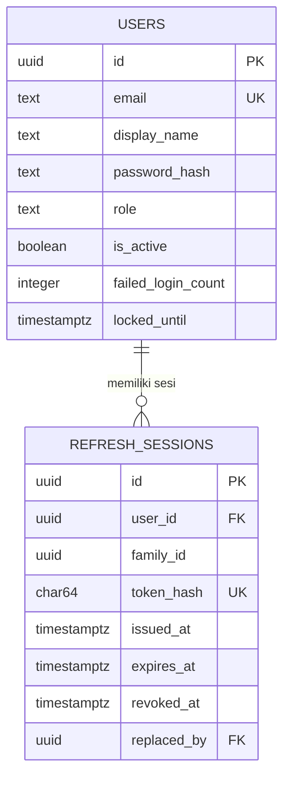
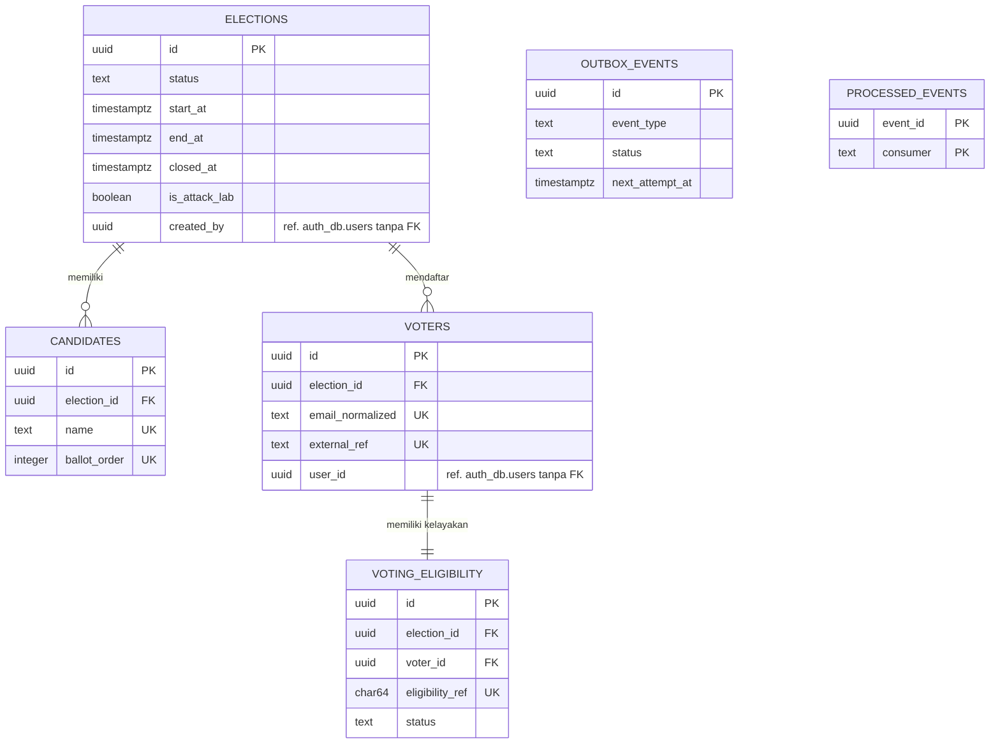
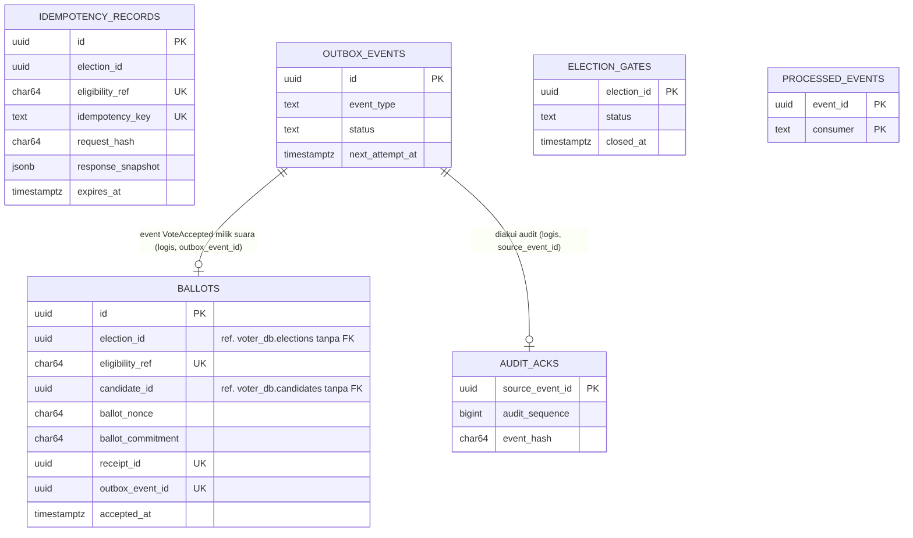
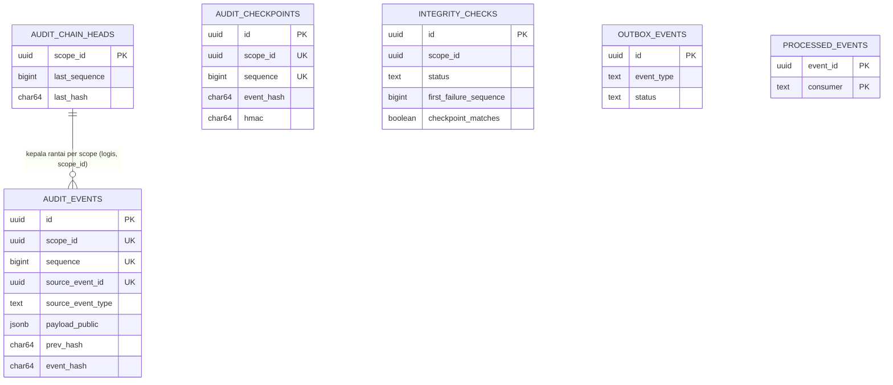
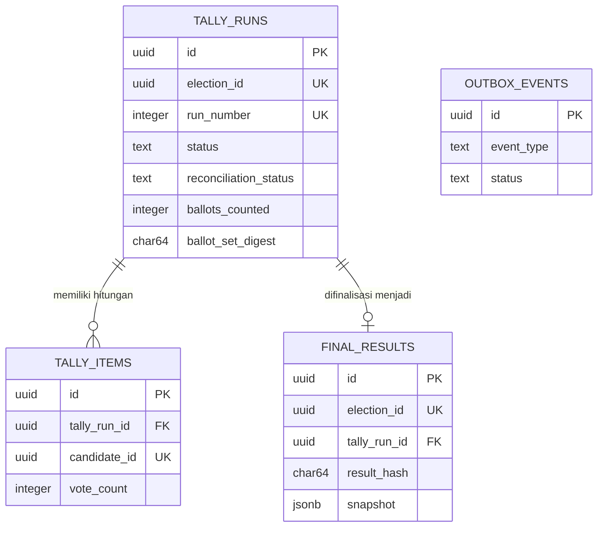
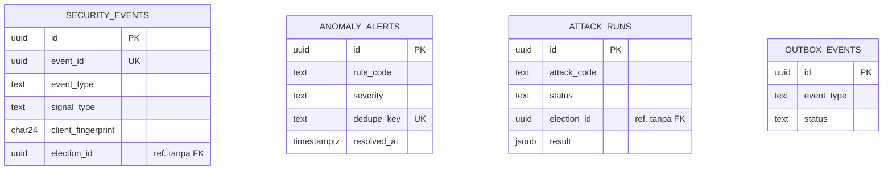

# VoxGuard — Database Design / ERD

## 1. Document Information

| Atribut | Nilai |
|---|---|
| Nama dokumen | Database Design / ERD |
| Proyek | VoxGuard — Verifiable Digital Election System |
| Versi / Status | 0.1 / **Draft — rancangan, belum disetujui, belum ada migration** |
| Tanggal | 2026-10-10 |
| Pemilik | `[PEMILIK-DOKUMEN]` (placeholder) |
| Dokumen acuan | `01_PROJECT_CHARTER.md`, `02_SOFTWARE_REQUIREMENTS_SPECIFICATION.md` (SRS), `03_SYSTEM_ARCHITECTURE_DOCUMENT.md` (SAD). Pendamping lama (tidak diubah): `ARCHITECTURE.md` D, `API_CONTRACTS.md`, `SECURITY_AND_TEST_PLAN.md` |

| Versi | Tanggal | Perubahan |
|---|---|---|
| 0.1 | 2026-10-10 | Draf awal |

**Status implementasi:** repository belum berisi kode, migration, atau konfigurasi database. Seluruh isi dokumen adalah **rancangan**. Skema di bawah menjabarkan SAD Bagian 7–8 dan **menggantikan** rincian kolom di `ARCHITECTURE.md` D bila ada selisih; selisih dicatat pada Bagian 13.

---

## 2. Database Design Principles

| Prinsip | Penerapan (rancangan) |
|---|---|
| **Database-per-service** | Enam database logis (`auth_db`, `voter_db`, `ballot_db`, `audit_db`, `result_db`, `security_db`) pada satu instance PostgreSQL lokal. Tidak ada tabel milik satu layanan di database layanan lain |
| **Ownership** | Setiap tabel dimiliki tepat satu layanan (Bagian 3). Layanan lain hanya lewat API internal atau event |
| **Referential integrity** | Foreign key **hanya lokal** (dalam satu database). Referensi lintas layanan berupa UUID tanpa FK; integritasnya divalidasi lewat API, event, dan rekonsiliasi (Bagian 4) |
| **Data minimization** | Tidak ada kolom tanpa tujuan jelas; tidak ada `user_id`/email di `ballots`; payload audit/event ter-allowlist |
| **Separation of concerns** | Identitas, kelayakan, isi suara, audit, dan hasil berada di database berbeda (Bagian 7) |
| **Transaction boundaries** | Transaksi hanya lokal per database; tidak ada transaksi lintas layanan atau ke RabbitMQ (Bagian 8) |
| **Indexing** | Indeks untuk constraint (unique) dan jalur baca utama saja; indeks tambahan hanya bila ada query nyata (Bagian 6) |
| **Migration** | Alembic per layanan (Bagian 10) |
| **Retention** | Kebijakan eksplisit; durasi **OPEN DECISION** (Bagian 9) |
| **Backup/recovery** | Kebutuhan operasional; belum aktif (Bagian 11) |

**Batas klaim isolasi.** Isolasi data hanya berlaku bila setiap layanan benar-benar memakai role database terpisah (`auth_app`, `voter_app`, `ballot_app`, `audit_app`, `result_app`, `security_app`) dengan hak minimum. Itu **rancangan**; belum ada yang dibuat. Jika pada implementasi awal semua layanan memakai satu akun luas, tidak boleh diklaim ada isolasi keamanan antar database — hanya pemisahan logis. Superuser/administrator PostgreSQL tetap dapat membaca semua database (batas diakui di SAD Bagian 8.3).

**Konvensi tipe PostgreSQL.**

| Kebutuhan | Pilihan | Alasan |
|---|---|---|
| ID | `uuid` (`gen_random_uuid()`, PostgreSQL ≥ 13) | Tidak berurutan/tidak dapat ditebak; dapat dibuat di aplikasi atau DB; aman sebagai referensi lintas layanan |
| Waktu | `timestamptz` (UTC) | Tanpa ambiguitas zona waktu |
| Status | `text` + `CHECK (... IN (...))` | Lebih mudah dimigrasi daripada `ENUM` PostgreSQL (menambah nilai tanpa `ALTER TYPE`); nilai tetap terjaga di DB |
| Hash/SHA-256 hex | `char(64)` + `CHECK (col ~ '^[0-9a-f]{64}$')` | Panjang tetap, divalidasi |
| Hitungan suara | `integer` (≥ 0); urutan chain `bigint` | 2^31 cukup untuk skala MVP (≤ 1.000 pemilih); `bigint` untuk sequence yang monoton |
| Data semi-terstruktur | `jsonb` hanya untuk payload event, snapshot respons, evidence | Struktur tetap yang diquery memakai kolom biasa |

---

## 3. Database Ownership Matrix

Hanya role database milik layanan yang boleh mengakses databasenya (rancangan). Kolom terakhir menjelaskan satu-satunya jalur data lintas layanan.

| Service | Database | Tabel dimiliki | Data sensitif | Akses diizinkan | Pertukaran data lintas service |
|---|---|---|---|---|---|
| auth-service | `auth_db` | `users`, `refresh_sessions` | Email, `password_hash`, `token_hash` | `auth_app` | Klaim JWT ke Gateway; sinyal keamanan (event best-effort) |
| voter-service | `voter_db` | `elections`, `candidates`, `voters`, `voting_eligibility`, `outbox_events`\*, `processed_events`\* | Email/`external_ref` pemilih, `eligibility_ref` | `voter_app` | API internal `ballot-info`, `eligibility/tickets`, `summary`; event `ElectionOpened/Closed`; konsumsi `VoteAccepted`, `ResultFinalized` |
| ballot-service | `ballot_db` | `ballots`, `idempotency_records`, `outbox_events`, `election_gates`\*, `audit_acks`\*, `processed_events`\* | `candidate_id`, `ballot_nonce`, `eligibility_ref` | `ballot_app` | API internal `tally-export`, `summary`, `outbox/stats`; event `VoteAccepted/Rejected`; konsumsi `ElectionOpened/Closed`, `AuditRecorded` |
| audit-service | `audit_db` | `audit_events`, `integrity_checks`, `audit_chain_heads`\*, `audit_checkpoints`\*, `outbox_events`\*, `processed_events`\* | Tidak ada PII (payload ter-allowlist); kunci HMAC checkpoint di environment | `audit_app` | API internal `summary`, `commitments`, `verify`; event `AuditRecorded`, sinyal integritas |
| result-service | `result_db` | `tally_runs`, `tally_items`, `final_results`, `outbox_events`\* | Hasil per kandidat (sensitivitas bergantung status: sementara dibatasi) | `result_app` | Memanggil API internal Ballot/Audit/Voter; event `TallyCompleted`, `ResultFinalized` |
| security-service | `security_db` | `security_events`, `anomaly_alerts`, `attack_runs`, `outbox_events`\* | `client_fingerprint` (HMAC IP) | `security_app` | Konsumsi event; polling `outbox/stats`; event `SecurityAlertRaised` |

\* **Tabel tambahan di luar baseline prompt** (alasan dan pemilik):

| Tabel | Pemilik | Alasan |
|---|---|---|
| `outbox_events` (di voter, audit, result, security) | masing-masing | Setiap penerbit event bisnis memerlukan outbox lokal (SAD 11.3); Ballot sudah ada di baseline |
| `processed_events` (voter, ballot, audit) | masing-masing | Deduplikasi konsumen idempotent; konsumen Security memakai `UNIQUE(event_id)` pada `security_events` |
| `election_gates` | ballot | Menolak suara cepat setelah `ElectionClosed` tanpa membaca `voter_db` (pertahanan berlapis) |
| `audit_acks` | ballot | Menunjukkan status audit receipt (`RECORDED`) tanpa mengakses `audit_db` |
| `audit_chain_heads` | audit | Kunci baris serialisasi append chain per scope |
| `audit_checkpoints` | audit | Anchor integritas (SAD 12) |

---

## 4. ERD Per Service

Garis relasi hanya untuk foreign key **lokal**. Kolom bertanda komentar "ref." adalah UUID referensi lintas layanan tanpa FK. Kunci `UK` = bagian dari unique constraint (lihat Bagian 5–6 untuk komposit).

### 4.1 `auth_db`



### 4.2 `voter_db`



### 4.3 `ballot_db`



Relasi `ballots.outbox_event_id → outbox_events.id` **dapat** diwujudkan sebagai FK lokal (satu database) dan diusulkan demikian; `audit_acks.source_event_id` tidak diberi FK karena `AuditRecorded` bisa tiba sebelum baris outbox lama dibersihkan (retensi). Kolom `election_id`, `candidate_id`, `eligibility_ref` pada `ballots` sengaja tanpa FK lintas database.

### 4.4 `audit_db`



`scope_id` = `election_id` (UUID referensi) atau konstanta GLOBAL `00000000-0000-0000-0000-000000000000`; tidak ada FK ke `voter_db`.

### 4.5 `result_db`



### 4.6 `security_db`



Tidak ada relasi FK antar tabel `security_db` (alert merujuk bukti secara logis lewat `evidence` jsonb, bukan FK) — disengaja agar penghapusan event lama tidak menghapus alert.

**Integritas referensi lintas layanan** (tanpa FK):

| Referensi | Divalidasi lewat |
|---|---|
| `ballots.election_id/candidate_id` → `voter_db` | `ballot-info` (Voter) saat suara diterima; rekonsiliasi saat tally |
| `voters.user_id`, `elections.created_by` → `auth_db` | Klaim JWT dari Gateway saat dibuat/diklaim |
| `audit_events.scope_id` → election | Event `ElectionOpened`; scope GLOBAL untuk lainnya |
| `tally_items.candidate_id` → kandidat | Snapshot nama dari Voter saat tally |
| `security_events.election_id`, `attack_runs.election_id` | Dari payload event / pembuatan election lab; informatif |

---

## 5. Table Specifications

Legenda: **PK** primary key, **FK** foreign key lokal, **UQ** bagian unique constraint, **NN** NOT NULL, **Null** boleh null. Sensitivitas: **PUB** publik/tidak sensitif, **INT** internal, **PII** data pribadi (fiktif pada data uji), **SEC** rahasia/kredensial, **PRIV** privasi suara (kerahasiaan pilihan).

### 5.1 `auth_db.users`

| Kolom | Tipe | Null | Key | Default | Sens. | Deskripsi |
|---|---|---|---|---|---|---|
| `id` | `uuid` | NN | PK | `gen_random_uuid()` | INT | ID akun |
| `email` | `text` | NN | UQ | — | PII | Lowercase; `CHECK (email = lower(email))`, panjang ≤ 254 |
| `display_name` | `text` | NN | — | — | PII | 1–100 karakter |
| `password_hash` | `text` | NN | — | — | SEC | Argon2id; tidak pernah di-log/dikembalikan |
| `role` | `text` | NN | — | `'VOTER'` | INT | `CHECK IN ('ADMIN','VOTER','AUDITOR')` |
| `is_active` | `boolean` | NN | — | `true` | INT | Penonaktifan akun |
| `failed_login_count` | `integer` | NN | — | `0` | INT | `CHECK >= 0`; lockout |
| `locked_until` | `timestamptz` | Null | — | — | INT | Batas kunci sementara |
| `last_login_at` | `timestamptz` | Null | — | — | INT | Login terakhir |
| `created_at`, `updated_at` | `timestamptz` | NN | — | `now()` | INT | Audit teknis |

### 5.2 `auth_db.refresh_sessions`

| Kolom | Tipe | Null | Key | Default | Sens. | Deskripsi |
|---|---|---|---|---|---|---|
| `id` | `uuid` | NN | PK | `gen_random_uuid()` | INT | |
| `user_id` | `uuid` | NN | FK→`users.id` `ON DELETE CASCADE` | — | INT | Pemilik sesi |
| `family_id` | `uuid` | NN | — | — | INT | Satu keluarga per login; dicabut bersama saat reuse |
| `token_hash` | `char(64)` | NN | UQ | — | SEC | SHA-256 refresh token (token asli tidak disimpan) |
| `issued_at` | `timestamptz` | NN | — | `now()` | INT | |
| `expires_at` | `timestamptz` | NN | — | — | INT | `CHECK (expires_at > issued_at)` |
| `rotated_at`, `revoked_at` | `timestamptz` | Null | — | — | INT | Rotasi/pencabutan |
| `replaced_by` | `uuid` | Null | FK→`refresh_sessions.id` | — | INT | Rantai rotasi |
| `ip_hash` | `char(24)` | Null | — | — | INT | HMAC IP terpotong (minimisasi) |

### 5.3 `voter_db.elections`

| Kolom | Tipe | Null | Key | Default | Sens. | Deskripsi |
|---|---|---|---|---|---|---|
| `id` | `uuid` | NN | PK | `gen_random_uuid()` | PUB | |
| `title` | `text` | NN | — | — | PUB | `CHECK (char_length(title) BETWEEN 3 AND 150)` |
| `description` | `text` | NN | — | `''` | PUB | ≤ 2000 |
| `status` | `text` | NN | — | `'DRAFT'` | PUB | `CHECK IN ('DRAFT','SCHEDULED','OPEN','CLOSED','FINALIZED')` |
| `start_at`, `end_at` | `timestamptz` | NN | — | — | PUB | `CHECK (start_at < end_at)` |
| `opened_at`, `closed_at`, `finalized_at` | `timestamptz` | Null | — | — | PUB | Diisi pada transisi; `CHECK (closed_at IS NULL OR opened_at IS NOT NULL)` |
| `is_attack_lab` | `boolean` | NN | — | `false` | INT | Penanda election Attack Lab |
| `created_by` | `uuid` | NN | — (ref. `users.id`) | — | INT | Admin pembuat; tanpa FK lintas DB |
| `created_at`, `updated_at` | `timestamptz` | NN | — | `now()` | INT | |
| `version` | `integer` | NN | — | `1` | INT | Optimistic locking transisi |

### 5.4 `voter_db.candidates`

| Kolom | Tipe | Null | Key | Default | Sens. | Deskripsi |
|---|---|---|---|---|---|---|
| `id` | `uuid` | NN | PK | `gen_random_uuid()` | PUB | |
| `election_id` | `uuid` | NN | FK→`elections.id` | — | PUB | |
| `name` | `text` | NN | UQ(`election_id`,`name`) | — | PUB | 1–100 |
| `description` | `text` | NN | — | `''` | PUB | ≤ 1000 |
| `ballot_order` | `integer` | NN | UQ(`election_id`,`ballot_order`) | — | PUB | `CHECK (ballot_order >= 1)` |
| `created_at` | `timestamptz` | NN | — | `now()` | INT | |

Perubahan hanya saat `elections.status = 'DRAFT'` (ditegakkan aplikasi + trigger opsional, OD-22).

### 5.5 `voter_db.voters`

| Kolom | Tipe | Null | Key | Default | Sens. | Deskripsi |
|---|---|---|---|---|---|---|
| `id` | `uuid` | NN | PK | `gen_random_uuid()` | INT | |
| `election_id` | `uuid` | NN | FK→`elections.id`; UQ(`election_id`,`id`) | — | INT | UQ komposit untuk FK komposit dari `voting_eligibility` |
| `email_normalized` | `text` | NN | UQ(`election_id`,`email_normalized`) | — | PII | Lowercase |
| `external_ref` | `text` | NN | UQ(`election_id`,`external_ref`) | — | PII | Mis. nomor induk fiktif pada data uji |
| `display_label` | `text` | NN | — | — | PII | Label tampilan |
| `user_id` | `uuid` | Null | UQ parsial(`election_id`,`user_id`) `WHERE user_id IS NOT NULL` | — | PII | Terisi saat klaim pertama; satu akun hanya boleh mengikat **satu** baris pemilih per pemilihan (mencegah satu akun mengklaim dua kelayakan) |
| `created_at` | `timestamptz` | NN | — | `now()` | INT | |

### 5.6 `voter_db.voting_eligibility`

| Kolom | Tipe | Null | Key | Default | Sens. | Deskripsi |
|---|---|---|---|---|---|---|
| `id` | `uuid` | NN | PK | `gen_random_uuid()` | INT | |
| `election_id` | `uuid` | NN | FK komposit (`election_id`,`voter_id`)→`voters(election_id,id)` | — | INT | Menjamin konsistensi pemilihan |
| `voter_id` | `uuid` | NN | UQ(`election_id`,`voter_id`) | — | INT | Satu kelayakan per pemilih per pemilihan |
| `eligibility_ref` | `char(64)` | NN | UQ(`election_id`,`eligibility_ref`) | — | PRIV | HMAC pseudonim (SAD 8.3); dikirim ke Ballot lewat ticket |
| `status` | `text` | NN | — | `'ELIGIBLE'` | INT | `CHECK IN ('ELIGIBLE','TICKET_ISSUED','VOTED','REVOKED')` |
| `ticket_issued_at`, `voted_marked_at` | `timestamptz` | Null | — | — | PRIV | Metadata waktu (risiko korelasi, Bagian 7) |
| `created_at`, `updated_at` | `timestamptz` | NN | — | `now()` | INT | |

### 5.7 `ballot_db.ballots` (append-only)

| Kolom | Tipe | Null | Key | Default | Sens. | Deskripsi |
|---|---|---|---|---|---|---|
| `id` | `uuid` | NN | PK | `gen_random_uuid()` | PRIV | |
| `election_id` | `uuid` | NN | UQ(`election_id`,`eligibility_ref`) | — | INT | Ref. tanpa FK |
| `eligibility_ref` | `char(64)` | NN | (di UQ di atas) | — | PRIV | Pseudonim dari ticket |
| `candidate_id` | `uuid` | NN | — | — | **PRIV** | Pilihan; tidak dikirim ke event/audit/log |
| `ballot_nonce` | `char(64)` | NN | — | — | **PRIV** | 256-bit acak; hanya untuk commitment |
| `ballot_commitment` | `char(64)` | NN | — | — | INT | SHA-256 (SAD 12); `CHECK` hex |
| `receipt_id` | `uuid` | NN | UQ | `gen_random_uuid()` | INT | ID receipt acak |
| `outbox_event_id` | `uuid` | NN | UQ; FK→`outbox_events.id` | — | INT | Penghubung ke event `VoteAccepted` |
| `status` | `text` | NN | — | `'ACCEPTED'` | INT | `CHECK (status = 'ACCEPTED')` |
| `accepted_at` | `timestamptz` | NN | — | `now()` | PRIV | Metadata waktu |

Tidak ada kolom `user_id`, email, IP, atau nama.

### 5.8 `ballot_db.idempotency_records`

| Kolom | Tipe | Null | Key | Default | Sens. | Deskripsi |
|---|---|---|---|---|---|---|
| `id` | `uuid` | NN | PK | `gen_random_uuid()` | INT | |
| `election_id` | `uuid` | NN | — | — | INT | |
| `eligibility_ref` | `char(64)` | NN | UQ(`eligibility_ref`,`idempotency_key`) | — | PRIV | Ruang lingkup key: per hak memilih |
| `idempotency_key` | `text` | NN | (di UQ) | — | INT | `CHECK (idempotency_key ~ '^[A-Za-z0-9_-]{16,64}$')` |
| `request_hash` | `char(64)` | NN | — | — | INT | SHA-256 canonical `{election_id, candidate_id}` |
| `response_snapshot` | `jsonb` | NN | — | — | INT | `receipt_id`, `election_id`, `accepted_at` (tanpa `candidate_id`) |
| `created_at`, `expires_at` | `timestamptz` | NN | — | `now()` / — | INT | Pembersihan setelah kedaluwarsa |

### 5.9 `ballot_db.election_gates` dan `ballot_db.audit_acks`

| Kolom | Tipe | Null | Key | Default | Sens. | Deskripsi |
|---|---|---|---|---|---|---|
| `election_gates.election_id` | `uuid` | NN | PK | — | INT | |
| `election_gates.status` | `text` | NN | — | — | INT | `CHECK IN ('OPEN','CLOSED')` |
| `election_gates.closed_at` | `timestamptz` | Null | — | — | INT | |
| `election_gates.updated_at` | `timestamptz` | NN | — | `now()` | INT | |
| `audit_acks.source_event_id` | `uuid` | NN | PK | — | INT | = `ballots.outbox_event_id` |
| `audit_acks.audit_sequence` | `bigint` | NN | — | — | INT | |
| `audit_acks.event_hash` | `char(64)` | NN | — | — | INT | |
| `audit_acks.recorded_at` | `timestamptz` | NN | — | — | INT | |

### 5.10 `audit_db.audit_events` (append-only)

| Kolom | Tipe | Null | Key | Default | Sens. | Deskripsi |
|---|---|---|---|---|---|---|
| `id` | `uuid` | NN | PK | `gen_random_uuid()` | PUB | |
| `scope_id` | `uuid` | NN | UQ(`scope_id`,`sequence`) | — | PUB | Election atau GLOBAL |
| `sequence` | `bigint` | NN | (di UQ) | — | PUB | Mulai 1; `CHECK (sequence >= 1)` |
| `source_event_id` | `uuid` | NN | UQ | — | PUB | Dedup event sumber |
| `source_event_type` | `text` | NN | — | — | PUB | |
| `occurred_at`, `recorded_at` | `timestamptz` | NN | — | —/`now()` | PUB | |
| `correlation_id` | `uuid` | NN | — | — | INT | |
| `payload_public` | `jsonb` | NN | — | — | PUB | Hasil allowlist; **tanpa** identitas, `candidate_id`, `eligibility_ref` |
| `prev_hash`, `event_hash` | `char(64)` | NN | — | — | PUB | Hash chain; `CHECK` hex |

### 5.11 `audit_db` — tabel pendukung

| Tabel.Kolom | Tipe | Null | Key | Default | Sens. | Deskripsi |
|---|---|---|---|---|---|---|
| `audit_chain_heads.scope_id` | `uuid` | NN | PK | — | PUB | |
| `audit_chain_heads.last_sequence` | `bigint` | NN | — | `0` | PUB | |
| `audit_chain_heads.last_hash` | `char(64)` | NN | — | 64 × `'0'` | PUB | Genesis |
| `audit_chain_heads.updated_at` | `timestamptz` | NN | — | `now()` | INT | |
| `audit_checkpoints.id` | `uuid` | NN | PK | `gen_random_uuid()` | INT | |
| `audit_checkpoints.scope_id`, `.sequence` | `uuid`, `bigint` | NN | UQ(`scope_id`,`sequence`) | — | PUB | |
| `audit_checkpoints.event_hash` | `char(64)` | NN | — | — | PUB | |
| `audit_checkpoints.reason` | `text` | NN | — | — | INT | `CHECK IN ('ELECTION_CLOSED','RESULT_FINALIZED','PERIODIC','MANUAL')` |
| `audit_checkpoints.exported_path` | `text` | NN | — | — | INT | Lokasi di volume checkpoint |
| `audit_checkpoints.hmac` | `char(64)` | NN | — | — | SEC | HMAC dengan `AUDIT_CHECKPOINT_KEY` (kunci tidak di DB) |
| `audit_checkpoints.created_at` | `timestamptz` | NN | — | `now()` | INT | |
| `integrity_checks.id` | `uuid` | NN | PK | `gen_random_uuid()` | INT | |
| `integrity_checks.scope_id` | `uuid` | NN | — | — | PUB | |
| `integrity_checks.status` | `text` | NN | — | — | PUB | `CHECK IN ('VALID','INVALID')` |
| `integrity_checks.events_checked`, `.head_sequence` | `bigint` | NN | — | — | PUB | |
| `integrity_checks.head_hash` | `char(64)` | NN | — | — | PUB | |
| `integrity_checks.first_failure_sequence` | `bigint` | Null | — | — | PUB | Null bila `VALID` |
| `integrity_checks.failure_reason` | `text` | Null | — | — | INT | Mis. `EVENT_HASH_MISMATCH` |
| `integrity_checks.checkpoint_compared`, `.checkpoint_matches` | `boolean` | NN / Null | — | `false` / — | PUB | |
| `integrity_checks.requested_by` | `uuid` | Null | — | — | INT | Admin/Auditor pemanggil (ref.) |
| `integrity_checks.created_at` | `timestamptz` | NN | — | `now()` | INT | |

### 5.12 `result_db`

| Tabel.Kolom | Tipe | Null | Key | Default | Sens. | Deskripsi |
|---|---|---|---|---|---|---|
| `tally_runs.id` | `uuid` | NN | PK | `gen_random_uuid()` | INT | |
| `tally_runs.election_id`, `.run_number` | `uuid`, `integer` | NN | UQ(`election_id`,`run_number`) | — | INT | `CHECK (run_number >= 1)` |
| `tally_runs.status` | `text` | NN | — | `'RUNNING'` | INT | `CHECK IN ('RUNNING','COMPLETED','RECONCILIATION_FAILED','INTEGRITY_FAILED','FAILED')` |
| `tally_runs.closed_at` | `timestamptz` | NN | — | — | INT | Batas suara sah |
| `tally_runs.ballots_counted`, `.audit_vote_events`, `.voter_participation` | `integer` | NN / Null | — | — | INT | B, A, V; `CHECK >= 0` |
| `tally_runs.ballot_set_digest` | `char(64)` | Null | — | — | INT | |
| `tally_runs.audit_head_sequence`, `.audit_head_hash` | `bigint`, `char(64)` | Null | — | — | INT | |
| `tally_runs.reconciliation_status` | `text` | Null | — | — | INT | `CHECK IN ('MATCH','MISMATCH')` |
| `tally_runs.error_code` | `text` | Null | — | — | INT | |
| `tally_runs.started_by` | `uuid` | NN | — | — | INT | Admin (ref.) |
| `tally_runs.started_at`, `.completed_at` | `timestamptz` | NN / Null | — | `now()` / — | INT | |
| `tally_items.id` | `uuid` | NN | PK | `gen_random_uuid()` | INT | |
| `tally_items.tally_run_id` | `uuid` | NN | FK→`tally_runs.id`; UQ(`tally_run_id`,`candidate_id`) | — | INT | |
| `tally_items.candidate_id` | `uuid` | NN | (di UQ) | — | INT | Ref. tanpa FK |
| `tally_items.candidate_name` | `text` | NN | — | — | PUB | Snapshot nama |
| `tally_items.vote_count` | `integer` | NN | — | `0` | INT | `CHECK (vote_count >= 0)`; hasil sementara dibatasi aksesnya (BR-012) |
| `final_results.id` | `uuid` | NN | PK | `gen_random_uuid()` | PUB | |
| `final_results.election_id` | `uuid` | NN | UQ | — | PUB | Satu hasil final per pemilihan |
| `final_results.tally_run_id` | `uuid` | NN | FK→`tally_runs.id`; UQ | — | PUB | |
| `final_results.result_hash` | `char(64)` | NN | — | — | PUB | |
| `final_results.snapshot` | `jsonb` | NN | — | — | PUB | `items`, `total_ballots`, `ballot_set_digest`, `audit_head_hash` |
| `final_results.finalized_by` | `uuid` | NN | — | — | INT | |
| `final_results.finalized_at` | `timestamptz` | NN | — | `now()` | PUB | |

### 5.13 `security_db`

| Tabel.Kolom | Tipe | Null | Key | Default | Sens. | Deskripsi |
|---|---|---|---|---|---|---|
| `security_events.id` | `uuid` | NN | PK | `gen_random_uuid()` | INT | |
| `security_events.event_id` | `uuid` | NN | UQ | — | INT | Dedup |
| `security_events.source_service`, `.event_type` | `text` | NN | — | — | INT | |
| `security_events.signal_type`, `.reason_code` | `text` | Null | — | — | INT | |
| `security_events.election_id` | `uuid` | Null | — | — | INT | |
| `security_events.client_fingerprint` | `char(24)` | Null | — | — | INT | HMAC IP; bukan IP mentah |
| `security_events.details` | `jsonb` | NN | — | `'{}'` | INT | Allowlist; tanpa identitas/pilihan |
| `security_events.occurred_at`, `.received_at` | `timestamptz` | NN | — | —/`now()` | INT | |
| `anomaly_alerts.id` | `uuid` | NN | PK | `gen_random_uuid()` | INT | |
| `anomaly_alerts.rule_code` | `text` | NN | — | — | INT | `CHECK (rule_code ~ '^R-[0-9]{2}$')` |
| `anomaly_alerts.severity` | `text` | NN | — | — | INT | `CHECK IN ('LOW','MEDIUM','HIGH','CRITICAL')` |
| `anomaly_alerts.election_id` | `uuid` | Null | — | — | INT | |
| `anomaly_alerts.dedupe_key` | `text` | NN | UQ parsial `WHERE resolved_at IS NULL` | — | INT | |
| `anomaly_alerts.title`, `.description` | `text` | NN | — | — | INT | |
| `anomaly_alerts.evidence` | `jsonb` | NN | — | `'{}'` | INT | Tanpa identitas/pilihan |
| `anomaly_alerts.occurrence_count` | `integer` | NN | — | `1` | INT | |
| `anomaly_alerts.first_seen_at`, `.last_seen_at` | `timestamptz` | NN | — | `now()` | INT | |
| `anomaly_alerts.resolved_at` | `timestamptz` | Null | — | — | INT | |
| `attack_runs.id` | `uuid` | NN | PK | `gen_random_uuid()` | INT | |
| `attack_runs.attack_code` | `text` | NN | — | — | INT | `CHECK (attack_code ~ '^ATK-[0-9]{2}$')` |
| `attack_runs.status` | `text` | NN | — | `'QUEUED'` | INT | `CHECK IN ('QUEUED','RUNNING','PASSED','FAILED','ERROR')` |
| `attack_runs.election_id` | `uuid` | Null | — | — | INT | Election lab |
| `attack_runs.parameters`, `.result` | `jsonb` | NN / Null | — | `'{}'` / — | INT | Expected vs actual per langkah |
| `attack_runs.triggered_by` | `uuid` | NN | — | — | INT | Admin (ref.) |
| `attack_runs.started_at`, `.finished_at` | `timestamptz` | Null | — | — | INT | |
| `attack_runs.created_at` | `timestamptz` | NN | — | `now()` | INT | |

### 5.14 Tabel standar `outbox_events` dan `processed_events`

`outbox_events` ada di voter_db, ballot_db, audit_db, result_db, security_db dengan struktur identik:

| Kolom | Tipe | Null | Key | Default | Sens. | Deskripsi |
|---|---|---|---|---|---|---|
| `id` | `uuid` | NN | PK | `gen_random_uuid()` | INT | = `event_id` |
| `event_type`, `routing_key` | `text` | NN | — | — | INT | |
| `schema_version` | `text` | NN | — | `'1.0'` | INT | |
| `correlation_id` | `uuid` | NN | — | — | INT | |
| `payload` | `jsonb` | NN | — | — | INT | Sesuai kontrak (`05_API_CONTRACT_SPECIFICATION.md` Bagian 8); tanpa `candidate_id`/identitas |
| `status` | `text` | NN | — | `'PENDING'` | INT | `CHECK IN ('PENDING','PUBLISHED','FAILED')` |
| `attempts` | `integer` | NN | — | `0` | INT | |
| `next_attempt_at` | `timestamptz` | NN | — | `now()` | INT | |
| `created_at`, `published_at` | `timestamptz` | NN / Null | — | `now()` / — | INT | |
| `last_error` | `text` | Null | — | — | INT | ≤ 500 karakter, tanpa data sensitif |

`processed_events` (voter_db, ballot_db, audit_db): `event_id uuid NN`, `consumer text NN`, `processed_at timestamptz NN default now()`, **PK** `(event_id, consumer)`; sensitivitas INT.

---

## 6. Important Constraints and Indexes

### 6.1 Constraint penting

| ID | Constraint | Tujuan | Uji (lihat `07_TEST_PLAN_ACCEPTANCE_CRITERIA.md`) |
|---|---|---|---|
| DBC-01 | `users.email` UNIQUE + `CHECK email = lower(email)` | Akun unik, tanpa duplikat huruf besar/kecil | DB-01 |
| DBC-02 | `voters` UNIQUE(`election_id`,`email_normalized`) dan (`election_id`,`external_ref`) | Pemilih unik per pemilihan | DB-02 |
| DBC-03 | `voters` UNIQUE parsial(`election_id`,`user_id`) `WHERE user_id IS NOT NULL` | Satu akun tidak dapat mengklaim lebih dari satu kelayakan | DB-03 |
| DBC-04 | `voting_eligibility` UNIQUE(`election_id`,`voter_id`) dan (`election_id`,`eligibility_ref`) + FK komposit | Kelayakan unik per pemilih per pemilihan; konsisten dengan `voters` | DB-04 |
| DBC-05 | **`ballots` UNIQUE(`election_id`,`eligibility_ref`)** | Satu hak suara = paling banyak satu suara (penjaga akhir, tingkat database) | DB-05, CC-01 |
| DBC-06 | `idempotency_records` UNIQUE(`eligibility_ref`,`idempotency_key`) | Idempotency per hak memilih | DB-06, CC-02 |
| DBC-07 | `outbox_events.id` PK; `audit_events.source_event_id` UNIQUE; `security_events.event_id` UNIQUE; `processed_events` PK(`event_id`,`consumer`); `audit_acks.source_event_id` PK | Keunikan event ID dan dedup | DB-07, IT-AUD-02 |
| DBC-08 | `candidates` UNIQUE(`election_id`,`ballot_order`) dan (`election_id`,`name`); FK ke `elections` | Kandidat konsisten per pemilihan | DB-08 |
| DBC-09 | `CHECK` status lifecycle/tally/alert/dll. dan `start_at < end_at` | Hanya nilai valid | DB-09 |
| DBC-10 | `ballots`: trigger tolak `UPDATE`/`DELETE`; `REVOKE` hak `UPDATE/DELETE` dari `ballot_app` | Suara append-only | DB-10 |
| DBC-11 | `audit_events`: trigger tolak `UPDATE`/`DELETE`; hak `ballot`-setara untuk `audit_app` (`INSERT, SELECT`) | Catatan audit tidak diubah lewat aplikasi | DB-11 |
| DBC-12 | `final_results` UNIQUE(`election_id`) + trigger tolak `UPDATE`/`DELETE` | Hasil final tunggal dan immutable | DB-12 |
| DBC-13 | `tally_runs` UNIQUE(`election_id`,`run_number`); `tally_items` UNIQUE(`tally_run_id`,`candidate_id`) | Riwayat tally unik | DB-13 |
| DBC-14 | `anomaly_alerts` UNIQUE parsial(`dedupe_key`) `WHERE resolved_at IS NULL` | Dedup alert aktif | DB-14 |
| DBC-15 | `audit_events` UNIQUE(`scope_id`,`sequence`) + `audit_chain_heads` lock baris | Tidak ada dua entri dengan sequence sama | DB-15 |

Cuplikan DDL ilustratif (rancangan, bukan file migration):

```sql
ALTER TABLE ballots
  ADD CONSTRAINT uq_ballots_election_eligibility UNIQUE (election_id, eligibility_ref);

CREATE UNIQUE INDEX uq_voters_election_user
  ON voters (election_id, user_id) WHERE user_id IS NOT NULL;

CREATE FUNCTION forbid_mutation() RETURNS trigger AS $$
BEGIN RAISE EXCEPTION 'append-only table'; END; $$ LANGUAGE plpgsql;
CREATE TRIGGER trg_ballots_immutable BEFORE UPDATE OR DELETE ON ballots
  FOR EACH ROW EXECUTE FUNCTION forbid_mutation();
```

Catatan: trigger dan pencabutan hak tidak menghentikan superuser; keduanya adalah pertahanan terhadap kesalahan aplikasi dan akun layanan, bukan terhadap administrator database.

### 6.2 Indeks (di luar indeks unik/PK)

| Tabel | Indeks | Kebutuhan |
|---|---|---|
| `elections` | `(status)`, `(created_by)` | Daftar/pencarian pemilihan |
| `candidates` | (tercakup UQ `election_id`…) | Daftar kandidat per pemilihan |
| `voters` | `(election_id, user_id)` (tercakup UQ parsial), `(election_id, email_normalized)` (UQ) | Pencocokan klaim kelayakan |
| `voting_eligibility` | `(election_id, status)` | Statistik partisipasi |
| `refresh_sessions` | `(user_id)`, `(family_id)` | Pencabutan sesi/keluarga |
| `outbox_events` | `(status, next_attempt_at)`, `(created_at)` | Relay (`SKIP LOCKED`) |
| `idempotency_records` | `(expires_at)` | Pembersihan |
| `audit_events` | `(scope_id, sequence)` (UQ), `(source_event_type)` | Verifikasi chain, filter |
| `tally_runs` | `(election_id, started_at DESC)` | Riwayat tally |
| `security_events` | `(event_type, occurred_at)`, `(client_fingerprint, occurred_at)`, `(election_id, occurred_at)` | Evaluasi aturan R-xx berjendela waktu |
| `anomaly_alerts` | `(severity, last_seen_at DESC)` | Daftar alert |
| `attack_runs` | `(attack_code, created_at DESC)` | Riwayat simulasi |

### 6.3 Skenario dua request bersamaan

Dua request `POST /ballots` untuk `eligibility_ref` yang sama (A dan B), `READ COMMITTED`:

| Langkah | Request A | Request B |
|---|---|---|
| 1 | `INSERT idempotency_records` (key KA) | `INSERT idempotency_records` (key KB berbeda atau sama) |
| 2 | `INSERT ballots` → memperoleh kunci entri indeks unik `(election_id, eligibility_ref)` | `INSERT ballots` → **menunggu** transaksi A |
| 3 | `INSERT outbox_events`, `COMMIT` | Setelah A commit: PostgreSQL menolak insert B dengan `unique_violation` (SQLSTATE `23505`) |
| 4 | Respons `201` | Aplikasi `ROLLBACK` (idempotency record B ikut batal) → `409 VOTER_ALREADY_VOTED` |

Jika A `ROLLBACK`, B melanjutkan dan menjadi satu-satunya suara. Jika key sama + payload sama, B menunggu pada langkah 1 (konflik unik `idempotency_records`), lalu membaca snapshot A dan mengembalikan `200` replay. Hasil: untuk satu `(election_id, eligibility_ref)` tersimpan **paling banyak satu** baris `ballots`, apa pun urutan eksekusi; jaminan berasal dari indeks unik, bukan dari pemeriksaan aplikasi (`SELECT` lalu `INSERT` tidak diandalkan).

---

## 7. Ballot Privacy and Data Separation

### 7.1 Klasifikasi data

| Kategori | Data | Tabel/kolom (layanan) | Boleh masuk audit? |
|---|---|---|---|
| Identitas pemilih | Email, nama, `external_ref`, `user_id` | `users` (auth); `voters` (voter) | **Tidak** |
| Bukti berhak memilih | Baris `voters` + `voting_eligibility` (`eligibility_ref`, status), vote ticket | voter; ticket berumur pendek | **Tidak** (`eligibility_ref` dibuang oleh Audit) |
| Penggunaan hak suara | Keberadaan baris `ballots` dengan `eligibility_ref`; status `VOTED` di Voter | ballot; voter | Jumlah/agregat saja; **tanpa** `eligibility_ref` |
| Pilihan kandidat | `ballots.candidate_id` (+ `ballot_nonce`) | ballot | **Tidak** |
| Tanda terima | `receipt_id` (+ kode HMAC turunan, tidak disimpan) | ballot | `receipt_id` boleh (acak, tanpa identitas/pilihan) |
| Catatan audit | `payload_public`: `election_id`, `ballot_id`, `receipt_id`, `accepted_at`, `ballot_commitment` | audit | Ya (allowlist) |

### 7.2 Rancangan pemisahan

- **Tidak ada tabel atau relasi tunggal** yang memuat identitas dan `candidate_id`. Tautan identitas↔suara bergantung pada **dua** lompatan lintas database: `users/voters → voting_eligibility.eligibility_ref` (voter_db) dan `ballots.eligibility_ref → candidate_id` (ballot_db).
- `eligibility_ref = HMAC-SHA256(ELIGIBILITY_PEPPER, election_id | voter_id)`: stabil per pemilihan (diperlukan agar UNIQUE mencegah suara ganda), berbeda antar pemilihan, tidak dapat dibalik tanpa pepper.
- `POST /ballots` tidak membawa identitas (header identitas dibuang Gateway); ticket tidak berisi `user_id`.
- Audit hanya menerima `ballot_commitment` = SHA-256 dengan nonce 256-bit sehingga perubahan `candidate_id` dapat dideteksi tanpa mengungkap pilihan.
- Receipt, log, `VoteAccepted`/`VoteRejected`, `SecurityAlertRaised`, dan `anomaly_alerts.evidence` tidak memuat pilihan.

### 7.3 Trade-off

| Tujuan | Konsekuensi |
|---|---|
| Pencegahan suara ganda | Membutuhkan pengenal kelayakan yang **stabil** per pemilihan (`eligibility_ref`) di `ballots`; pengenal ini adalah pseudonim yang dapat ditautkan ke identitas oleh pemegang `voter_db` + pepper |
| Auditabilitas | Commitment dan receipt memungkinkan pemeriksaan jumlah/integritas tanpa membuka pilihan, tetapi pemilih tidak dapat membuktikan pilihannya sendiri (tidak ada receipt-freeness bocor, tetapi juga bukan E2E-verifiable) |
| Anonimitas | Metadata waktu (`ticket_issued_at`, `accepted_at`, log Gateway) dapat dikorelasikan, terutama pada pemilih sedikit; ukuran himpunan anonimitas = jumlah pemilih yang memilih pada jendela serupa |

### 7.4 Batas yang dinyatakan

Pseudonimisasi dan pemisahan database **mengurangi** risiko pengaitan, tetapi **tidak menjamin anonimitas sempurna**: (1) administrator/DBA yang membaca `voter_db` dan `ballot_db` (atau menguasai pepper) dapat menautkan; (2) korelasi waktu dan log; (3) kolusi layanan. Perlindungan lebih kuat (mis. blind signature) di luar MVP. Detail ancaman: `06_THREAT_MODEL_SECURITY_DESIGN.md` Bagian 10.

---

## 8. Transaction Boundaries

| Layanan | Transaksi lokal (satu database) | Di luar transaksi |
|---|---|---|
| **ballot-service** `POST /ballots` | `BEGIN` → `INSERT idempotency_records` → `INSERT ballots` (UNIQUE) → `INSERT outbox_events(VoteAccepted)` → `UPDATE idempotency_records.response_snapshot` → `COMMIT`. Satu COMMIT mencakup pencatatan suara, pencegahan ganda, idempotency, dan outbox | Cek status ke Voter (sebelum transaksi, sinkron); publikasi ke RabbitMQ |
| ballot `VoteRejected` | Transaksi singkat terpisah: `INSERT outbox_events(VoteRejected)` | Tidak mempengaruhi keputusan penolakan |
| ballot konsumsi `AuditRecorded` | `INSERT audit_acks` + `INSERT processed_events` | ack ke broker setelah COMMIT |
| **outbox relay** (tiap penerbit) | `SELECT … FOR UPDATE SKIP LOCKED` → publish dengan confirm → `UPDATE status='PUBLISHED'` | **Publish ke RabbitMQ bukan bagian transaksi DB**: crash setelah publish sebelum update → event terkirim ulang (at-least-once) |
| **voter-service** | Transisi lifecycle: `UPDATE elections` + `INSERT outbox_events` (+ `INSERT voting_eligibility` saat `schedule`) atomik; penerbitan ticket: `UPDATE voting_eligibility`; konsumsi `VoteAccepted`: `UPDATE voting_eligibility` + `processed_events` | Panggilan dari Ballot (sinkron) |
| **audit-service** | `BEGIN` → `SELECT … FOR UPDATE audit_chain_heads` → `INSERT audit_events` → `UPDATE chain head` → `INSERT processed_events` → `INSERT outbox(AuditRecorded)` → `COMMIT` | Penulisan checkpoint ke volume (setelah COMMIT; kegagalannya tidak membatalkan entri) |
| **result-service** | Tally: `INSERT tally_runs/items` + outbox atomik; Finalize: `INSERT final_results` + outbox atomik | Panggilan sinkron ke Ballot/Audit/Voter sebelum transaksi |
| **security-service** | `INSERT security_events` (UNIQUE `event_id`) → evaluasi aturan → `INSERT/UPDATE anomaly_alerts` + outbox | Polling eksternal |
| **auth-service** | `INSERT users`; login: `INSERT refresh_sessions` + `UPDATE users`; refresh: rotasi atomik (`UPDATE` lama + `INSERT` baru) | Denylist Redis (di luar DB; best-effort) |

Tidak ada transaksi yang melintasi database layanan lain maupun RabbitMQ; konsistensi lintas layanan bersifat eventual dan dijaga outbox, konsumen idempotent, dan rekonsiliasi (SAD 11–13).

---

## 9. Data Lifecycle and Retention

Durasi retensi belum disepakati: **OPEN DECISION OD-17** (lihat Charter 14). Nilai di bawah adalah **usulan**.

| Fase | Data | Perlakuan |
|---|---|---|
| Pembuatan | `users`, `elections`, `candidates`, `voters`; `voting_eligibility` dibuat saat `schedule` | Validasi dan constraint |
| Pembaruan | `elections.status` per transisi; `voting_eligibility.status`; kandidat/pemilih dibekukan sejak `SCHEDULED` | Tidak ada pembaruan `ballots`, `audit_events`, `final_results` |
| Penutupan | `closed_at` terisi; gate Ballot `CLOSED`; checkpoint audit | Suara baru ditolak |
| Penghitungan | `tally_runs`/`tally_items` (boleh banyak run sebelum final) | Hasil sementara dibatasi (BR-012) |
| Finalisasi | `final_results` immutable; `ResultFinalized` di audit | Tally ulang ditolak (OD-13) |
| Pengarsipan | Ekspor data akhir (suara teragregasi, chain, checkpoint, `final_results`) | Bentuk dan lokasi OPEN DECISION |
| Retensi/penghapusan | Lihat tabel di bawah | Penghapusan hanya sesuai kebijakan eksplisit |

| Data | Usulan retensi (**OPEN DECISION**) | Penghapusan |
|---|---|---|
| `audit_events`, `audit_checkpoints`, `integrity_checks`, `final_results`, `tally_*` | Selama masa penilaian akademik + masa sanggah (durasi ditetapkan tim) | **Tidak dihapus otomatis**; hanya lewat prosedur yang tercatat |
| `ballots`, `idempotency_records` | Setelah `FINALIZED` dan periode sanggah; `idempotency_records` dapat dibersihkan setelah `expires_at` | Penghapusan suara individual dapat mengurangi kemampuan verifikasi ulang; keputusan eksplisit |
| `voters`, `voting_eligibility`, `users` | Hapus/anonimkan setelah pemilihan selesai bila tidak diperlukan (PII) | Anonimisasi (hapus email/label) lebih dulu |
| `outbox_events` `PUBLISHED`, `processed_events` | Pendek (mis. hari–minggu); `processed_events` tidak dihapus lebih cepat dari jendela ulang event terpanjang | Job pembersihan terjadwal |
| `security_events`, `anomaly_alerts`, `attack_runs` | Menengah | Pembersihan terjadwal; `attack_runs` data lab boleh dihapus kapan saja |
| Data uji (election lab) | Dibuang saat reset lingkungan | Reset penuh |

---

## 10. Migration Strategy

- **Alembic per layanan:** satu direktori `alembic/` dan satu `alembic_version` per database (`<service>/alembic/versions/`). **Dilarang** migration yang menyentuh lebih dari satu database/layanan.
- **Penamaan:** `NNNN_<slug>.py` (mis. `0001_create_users.py`), pesan revisi singkat; satu perubahan logis per file.
- **Urutan penerapan:** (1) inisialisasi infrastruktur (pembuatan database dan role) oleh skrip init PostgreSQL; (2) tiap layanan menjalankan `alembic upgrade head` di entrypoint sebelum `uvicorn` (satu replika per layanan menghindari balapan migrasi). Tidak ada ketergantungan antar-migration lintas layanan; urutan start layanan tidak berpengaruh pada skema.
- **Perubahan kompatibel (expand/contract):** tambah kolom nullable/default → deploy kode yang menulis keduanya → backfill → jadikan wajib → hapus kolom lama pada rilis berikutnya. Menambah nilai status memperbarui `CHECK` secara terkoordinasi dengan kode.
- **Rollback dan batasannya:** `downgrade` disediakan untuk pengembangan lokal; tidak menjamin pemulihan data (kolom yang dihapus kehilangan data). Migration yang membuat trigger/hak append-only harus punya downgrade eksplisit untuk lingkungan dev saja. Rollback pada data produksi/penilaian = restore dari backup (Bagian 11).
- **Pengujian:** MIG-01 upgrade dari database kosong ke `head` untuk setiap layanan; MIG-02 model SQLAlchemy vs skema migration tidak berbeda (`alembic check`/autogenerate kosong); MIG-03 upgrade dari revisi sebelumnya dengan data seed; MIG-04 downgrade satu langkah pada dev. Detail: dokumen 07.

---

## 11. Backup and Recovery

**Status: belum aktif; belum diimplementasikan.** Pendekatan yang diusulkan untuk prototipe lokal:

| Aspek | Rancangan |
|---|---|
| Backup | `pg_dump` per database (`-Fc`) ke direktori di luar volume `pg_data`, dijalankan manual sebelum demo, setelah `CLOSED` dan setelah `FINALIZED`; salinan volume `audit_checkpoints` |
| Konsistensi lintas database | Backup keenam database diambil pada waktu berdekatan setelah backlog outbox kosong. Restore sebagian (mis. hanya `ballot_db`) dapat membuat rekonsiliasi `MISMATCH` — dapat dideteksi tally (B/A/V) |
| Pemulihan | Hentikan layanan → restore database → jalankan migrasi `head` → verifikasi audit (`verify`) dan rekonsiliasi → start layanan |
| Keamanan backup | Backup berisi data sensitif (`ballots`, `voters`): diperlakukan seperti data asli; tidak di-commit ke repo; enkripsi/akses terbatas adalah kebutuhan hardening |
| Batasan | Satu mesin; tanpa replikasi/PITR; RPO/RTO belum ditetapkan (**OPEN DECISION OD-23**); backup di host yang sama tidak melindungi kegagalan host |
| Pengujian | REC-05 (uji restore) — PLANNED |

---

## 12. Database Validation Checklist

| # | Pemeriksaan | Status |
|---|---|---|
| 1 | **ERD valid:** diagram Mermaid dapat di-parse; tidak ada garis relasi lintas database | ☐ |
| 2 | **Model–migration konsisten:** MIG-02 (tidak ada drift) | ☐ |
| 3 | **Constraint:** DBC-01..15 ada di migration dan diuji (DB-01..15) | ☐ |
| 4 | **Race condition:** CC-01, CC-02, CC-03 menunjukkan paling banyak satu `ballots` per `(election_id, eligibility_ref)` | ☐ |
| 5 | **Pemisahan data sensitif:** tidak ada `user_id`/email di `ballots`; tidak ada `candidate_id`/`eligibility_ref` di audit/event/log (SEC-PRV-01..04) | ☐ |
| 6 | **Hak database:** `ballot_app`/`audit_app`/`result_app` tanpa `UPDATE/DELETE` pada tabel append-only (SEC-DB-01..03) | ☐ |
| 7 | **Indeks:** tiap query utama dicek `EXPLAIN` pada data uji; indeks tanpa kebutuhan dihapus | ☐ |
| 8 | **Retensi:** durasi diputuskan (OD-17) dan job pembersihan terdokumentasi | ☐ |
| 9 | **Pemulihan:** REC-05 restore berhasil dan rekonsiliasi `MATCH` | ☐ |
| 10 | **Ownership:** IT-ARCH-01 — tiap role hanya mengakses databasenya | ☐ |

Seluruh kotak kosong: **belum ada yang diverifikasi**.

---

## 13. Konflik, Keputusan Terbuka, dan Referensi Silang

| ID | Catatan | Penyelesaian yang disarankan |
|---|---|---|
| C-DB-01 | `ARCHITECTURE.md` D memakai `idempotency_records` UNIQUE(`eligibility_ref`,`idempotency_key`) dan semantik sama; **tambahan baru** di dokumen ini: UNIQUE parsial `voters(election_id,user_id)` dan FK komposit `voting_eligibility→voters` | Tambahan ini memperkuat BR-001; perbarui `ARCHITECTURE.md` D pada revisi berikutnya |
| C-DB-02 | Baseline prompt tidak menyebut `election_gates`, `audit_acks`, `audit_chain_heads`, `audit_checkpoints`, `processed_events` | Sudah ada di SAD Bagian 7; alasan di Bagian 3 |
| OD-22 | Pembekuan kandidat/pemilih ditegakkan aplikasi saja atau juga trigger DB | Usulan: aplikasi + uji; trigger bila waktu cukup |
| OD-23 | RPO/RTO backup | Tentukan tim; usulan: backup manual per tonggak |
| OD-17 | Durasi retensi | Lihat Bagian 9 |

Rujukan: kontrak API `05_API_CONTRACT_SPECIFICATION.md`; ancaman `06_THREAT_MODEL_SECURITY_DESIGN.md`; pengujian `07_TEST_PLAN_ACCEPTANCE_CRITERIA.md`; rencana kerja `08_PROJECT_PLAN_SPRINT_BACKLOG.md`.
