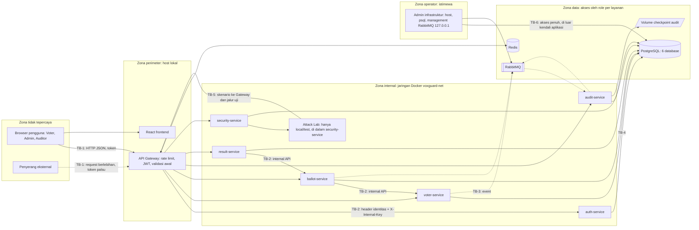

# VoxGuard — Threat Model / Security Design

## 1. Document Information

| Atribut | Nilai |
|---|---|
| Nama dokumen | Threat Model / Security Design |
| Proyek | VoxGuard — Verifiable Digital Election System |
| Versi / Status | 0.1 / **Draft — analisis desain; belum ditinjau, belum ada implementasi atau pengujian** |
| Tanggal | 2026-10-10 |
| Pemilik | `[PEMILIK-DOKUMEN]` (placeholder) |
| Acuan | `01_…`–`05_…`. Pendamping lama (tidak diubah): `SECURITY_AND_TEST_PLAN.md` (threat matrix TH-01..16 dan skenario Attack Lab ATK-01..10) |

| Versi | Tanggal | Perubahan |
|---|---|---|
| 0.1 | 2026-10-10 | Draf awal; memperluas TH-01..16 menjadi TH-01..23 (ID lama dipertahankan) |

Pendekatan: terinspirasi STRIDE dan *least privilege*; **bukan** sertifikasi atau audit profesional. Status semua kontrak: **diusulkan**; repository belum berisi kode, sehingga **tidak ada kontrol yang sudah diimplementasikan atau diuji**. Penilaian risiko adalah **estimasi awal tim**. Pengujian hanya pada sistem dan data yang dikendalikan tim.

---

## 2. System Security Objectives

| Tujuan | Kebutuhan untuk VoxGuard |
|---|---|
| Confidentiality | Pilihan individu dan identitas pemilih tidak terungkap ke pihak tak berwenang (termasuk Auditor); secret dan kredensial terlindung |
| Integrity | Suara, catatan audit, dan hasil tidak berubah tanpa terdeteksi; satu hak suara paling banyak satu suara |
| Availability | Voting tersedia selama pemilihan `OPEN`; kegagalan broker/audit tidak menghilangkan suara |
| Authentication | Pemanggil teridentifikasi (JWT, kunci internal) |
| Authorization | Role dan kelayakan ditegakkan di backend (least privilege) |
| Auditability | Aksi penting tercatat di rantai audit yang *tamper-evident* |
| Privacy | Minimisasi data; pemisahan identitas–pilihan; batas anonimitas dinyatakan |
| Result correctness | Hasil final = hitung ulang dari suara sah dan terekonsiliasi |

**Prioritas dan trade-off (usulan).** (1) Integritas suara/hasil dan kerahasiaan pilihan lebih utama daripada ketersediaan: Ballot **fail-closed** (503) bila status pemilihan tak dapat divalidasi — pemilih ditunda, bukan suara salah diterima. (2) Ketersediaan penerimaan suara diprioritaskan atas kelengkapan audit: suara tetap diterima saat Audit/RabbitMQ mati (audit menyusul; finalisasi ditolak sampai rekonsiliasi cocok). (3) Auditabilitas dibatasi oleh privasi: audit memuat commitment, bukan pilihan. (4) Pencegahan suara ganda menuntut pengenal stabil (`eligibility_ref`) yang mengurangi anonimitas (`04_…` 7.3).

---

## 3. Assets and Data Classification

Klasifikasi: **Rahasia** (kebocoran berdampak berat), **Terbatas** (hanya peran tertentu), **Internal**, **Publik-terbatas** (aman dipublikasikan sesuai desain). Dampak: Tinggi/Sedang/Rendah.

| ID | Aset | Lokasi | Klasifikasi | Dampak jika diakses | Dampak jika dimodifikasi |
|---|---|---|---|---|---|
| AS-01 | Credential (password hash) | `auth_db.users` | Rahasia | Tinggi (pengambilalihan akun) | Tinggi |
| AS-02 | Token dan session (JWT, refresh, ticket) | Klien, `refresh_sessions`, Redis | Rahasia | Tinggi (penyalahgunaan) | Sedang |
| AS-03 | Identitas pengguna/pemilih | `users`, `voters` | Terbatas (PII) | Sedang–Tinggi | Sedang |
| AS-04 | Daftar kelayakan pemilih | `voters`, `voting_eligibility` | Terbatas | Sedang | Tinggi (pemilih ditambah/dicabut) |
| AS-05 | Status penggunaan hak suara | `voting_eligibility.status`, `ballots` (keberadaan) | Terbatas | Sedang (siapa sudah memilih) | Tinggi |
| AS-06 | Pilihan kandidat | `ballots.candidate_id`, `ballot_nonce` | **Rahasia** | **Tinggi** (kerahasiaan pilihan, bila terkait identitas) | **Tinggi** (hasil) |
| AS-07 | Catatan audit | `audit_events`, checkpoint | Publik-terbatas | Rendah (sengaja ter-allowlist) | **Tinggi** (kepercayaan) |
| AS-08 | Hasil penghitungan | `tally_*`, `final_results` | Terbatas sebelum final; Publik-terbatas setelah final | Sedang (sebelum final) | **Tinggi** |
| AS-09 | Security events/alert | `security_db` | Internal | Rendah–Sedang | Sedang (menyembunyikan serangan) |
| AS-10 | Secrets (`JWT_SECRET`, `VOTE_TICKET_SECRET`, `ELIGIBILITY_PEPPER`, `RECEIPT_SECRET`, `INTERNAL_API_KEY`, `AUDIT_CHECKPOINT_KEY`) | Environment | Rahasia | **Tinggi** | Tinggi |
| AS-11 | Backup | `pg_dump`, volume checkpoint | Rahasia (berisi AS-03..08) | Tinggi | Tinggi |
| AS-12 | Message queue (event, DLQ) | RabbitMQ | Internal (tanpa pilihan/identitas; berisi `eligibility_ref` pada `VoteAccepted`) | Sedang | Tinggi (event palsu/hilang) |

---

## 4. Trust Boundaries and Attack Surface

| Batas | Data yang melintas | Kontrol yang diperlukan |
|---|---|---|
| TB-1 Browser↔Gateway | Kredensial, token, request voting, hasil | Validasi input, rate limit, JWT, CORS, header keamanan; TLS pada hardening |
| TB-2 Gateway/layanan↔layanan | Header identitas, kunci internal, ticket, ekspor tally | Jaringan internal; hanya Gateway dipublikasikan; header klien dibuang; kunci internal; RBAC ulang; pembatasan pemanggil |
| TB-3 Layanan↔RabbitMQ | Event (envelope + payload minimal) | Allowlist payload; validasi skema; kredensial broker per layanan (usulan); DLQ; dedup |
| TB-4 Layanan↔PostgreSQL | Data per layanan | Role per layanan, hak minimum, trigger append-only |
| TB-5 Attack Lab↔sistem | Simulasi serangan | Hanya `local`/`test`, `ATTACK_LAB_ENABLED`, hanya election `is_attack_lab`, tanpa target eksternal |
| TB-6 Operator↔host/DB | Seluruh data | **Tidak dapat dikontrol penuh** (residual, Bagian 14); pencatatan akses dan checkpoint |

**Attack surface:** `/api/v1/*` (publik), endpoint internal `/internal/v1/*` (terkunci jaringan + kunci), RabbitMQ, Redis, PostgreSQL, antarmuka management RabbitMQ (loopback), endpoint uji `/internal/v1/test/*` (hanya lingkungan uji), volume checkpoint, backup, berkas `.env`.

---

## 5. Threat Actors

| Aktor | Kemampuan | Niat/Masalah | Ancaman utama |
|---|---|---|---|
| Pengguna tidak terautentikasi | Request HTTP ke Gateway | Brute force, probing, DoS | TH-03, TH-10 |
| Pemilih curang | Akun sah, klien HTTP bebas, request paralel | Memilih berkali-kali, melihat hasil dini | TH-01, TH-02, TH-13 |
| Admin yang menyalahgunakan kewenangan | Akses API admin | Menutup dini, memanipulasi daftar pemilih, finalisasi bermasalah | TH-14, TH-17 |
| Pengembang (kesalahan konfigurasi) | Akses kode/konfigurasi | Port terbuka, secret di repo, debug aktif | TH-15, TH-21 |
| Penyerang jaringan terbatas | Dapat menjangkau port yang terekspos | Sniffing HTTP lokal, akses RabbitMQ management | TH-03, TH-12, TH-20 |
| Penyerang dengan akses database | Membaca/mengubah satu atau lebih DB | Mengubah suara/audit/hasil, menautkan identitas | TH-05, TH-06, TH-11, TH-12, TH-23 |
| Pengirim event duplikat/tidak valid | Akses ke broker atau bug konsumen | Menggandakan efek, menyuntik event palsu | TH-08, TH-20 |

Kemampuan tidak sama: operator/penyerang DB berada di luar perlindungan penuh; pengguna anonim hanya lewat Gateway.

---

## 6. STRIDE Threat Analysis

Skala: **L**ikelihood dan **S**everity: R (Rendah), S (Sedang), T (Tinggi) — estimasi awal tim. Kolom *Existing* = kontrol yang sudah ada: **tidak ada** (belum ada implementasi); semua mitigasi bersifat *diusulkan*. Test ID didefinisikan di `07_TEST_PLAN_ACCEPTANCE_CRITERIA.md` (semua PLANNED).

| ID | Komponen | Ancaman | STRIDE | Aset | Prasyarat | Dampak | L | S | Existing | Mitigasi diusulkan | Residual | Test |
|---|---|---|---|---|---|---|---|---|---|---|---|---|
| TH-01 | ballot | Suara dua kali berurutan | T | AS-05, AS-06 | Akun + ticket sah | Hasil tak sah | S | T | — | `UNIQUE(election_id, eligibility_ref)`; cek `VOTED` saat ticket; idempotency | Dua akun bila daftar salah (TH-14) | ATK-01, IT-BAL-02, DB-05 |
| TH-02 | ballot | Request paralel (race) | T | AS-05, AS-06 | Klien dapat mengirim paralel | Suara ganda | S | T | — | Satu transaksi + indeks unik menyerialkan; idempotency insert menunggu | Bug transaksi | ATK-02, CC-01, CC-02, CC-03 |
| TH-03 | Gateway, auth | Token hilang/palsu/kedaluwarsa; ticket palsu | S | AS-02 | Akses HTTP | Akses tak sah | S | T | — | Validasi JWT (exp, iss, aud, signature), denylist `jti`, ticket bertanda tangan terpisah | Bocor `JWT_SECRET` (HS256 bersama) | ATK-03, API-AUTH-08, UT-TKT-01 |
| TH-04 | Semua layanan | VOTER/AUDITOR memanggil fungsi ADMIN; akses hasil dini | E | AS-08, AS-04 | Token role rendah | Perubahan lifecycle/hasil | S | T | — | RBAC di Gateway **dan** layanan; matriks diuji otomatis | Konfigurasi role baru keliru | ATK-04, API-RBAC-01 |
| TH-05 | ballot, result | Perubahan langsung `ballots`/tally/`final_results` pada DB uji oleh akun layanan yang disusupi | T | AS-06, AS-08 | Akses SQL via akun layanan | Hasil berubah | R–S | T | — | Role tanpa UPDATE/DELETE; trigger; `ballot_commitment` + `result_hash` di audit; rekonsiliasi | Superuser DB (TH-11) | DB-10, DB-12, SEC-DB-01..03, IT-RES-04 |
| TH-06 | audit | Ubah/hapus/sisip/potong catatan audit | T, R | AS-07 | Akses tulis `audit_db` | Bukti tak tepercaya | R–S | T | — | Hash chain per scope; checkpoint ber-HMAC di volume terpisah; verifikasi berkala; trigger append-only | Penyerang menguasai DB **dan** kunci | ATK-06, SEC-AUD-01..04, DB-11 |
| TH-07 | ballot, voter | Suara setelah `CLOSED`/`end_at` | T | AS-06 | Ticket masih berlaku | Suara tidak sah | S | T | — | Cek sinkron status ke Voter + gate lokal + `end_at`; tally hanya `accepted_at ≤ closed_at` | Jendela sempit saat close; ditangani rekonsiliasi | ATK-05, IT-BAL-06, CC-03 |
| TH-08 | Semua konsumen | Event duplikat/terlambat/tak berurutan | T | AS-07, AS-08 | Redelivery broker | Efek ganda | T | S | — | `processed_events`/unique alami; tally dari ekspor Ballot (bukan event) | Status audit `PENDING` lebih lama | ATK-07, REC-04, IT-AUD-02, DB-07 |
| TH-09 | RabbitMQ | Broker mati/tertunda | D | AS-12 | Gangguan infrastruktur | Audit tertunda | S | S | — | Outbox, retry, DLQ, konsumen idempotent; alert R-06 | Signal best-effort hilang | ATK-08, REC-01..03 |
| TH-10 | Gateway, auth | Brute force login; request berlebihan | D, S | AS-01, AS-02 | Akses HTTP | Pengambilalihan akun / DoS | T | S | — | Rate limit Redis; lockout; Argon2id | DoS terdistribusi | ATK-09, API-RL-01..02, API-AUTH-07 |
| TH-11 | Host, DB | Admin infrastruktur/DBA membaca atau mengubah data | T, I, E | AS-03..AS-08 | Akses host/DB | Semua | R | T | — | Pemisahan DB/role; checkpoint; jejak audit; kebijakan akses | **Diterima** sebagai residual | SEC-DB-04 |
| TH-12 | voter, ballot, gateway | Kebocoran hubungan identitas–pilihan | I | AS-06, AS-03 | Akses ke dua DB, log, atau korelasi waktu | Pilihan terungkap | S | T | — | Ballot tanpa `user_id`; ticket berpseudonim; Gateway tanpa identitas untuk `POST /ballots`; allowlist audit/event/log | Kolusi DB, korelasi waktu | ATK-10, SEC-PRV-01..04 |
| TH-13 | Klien | Pencurian/replay access token atau vote ticket | S | AS-02 | Token tercuri | Suara oleh pihak lain | S | S | — | TTL pendek; ticket terikat election; `UNIQUE` batasi satu suara; logout/denylist | Pencuri mendahului pemilik | ATK-03 (varian), UT-TKT-01, SEC-TKN-01 |
| TH-14 | voter | Impersonasi kelayakan (daftar dengan email orang lain) atau Admin salah mengimpor | S | AS-04 | Email diketahui | Suara oleh bukan pemilik | S | T | — | Daftar diimpor Admin; klaim pertama mengikat `user_id`; UNIQUE parsial DBC-03; opsi `voter_code` (OD-01) | **Belum tertutup** pada MVP | IT-VOT-05, DB-03 |
| TH-15 | Semua | Kebocoran secret/data sensitif lewat log/repo | I | AS-10, AS-03 | Akses log/repo | Pengambilalihan | S | T | — | Filter log; `.env` di `.gitignore`; pemindaian secret | Kesalahan manusia | SEC-PRV-02, SEC-CFG-01 |
| TH-16 | ballot→voter | Voter/Audit tak tersedia saat voting | D | — (ketersediaan) | Gangguan | Pemilih tak dapat memilih | S | S | — | Fail-closed untuk status; Audit tidak memblokir suara | Voting berhenti saat Voter mati | IT-BAL-07, REC-02 |
| TH-17 | voter, result | Admin menyalahgunakan kewenangan (tutup dini, finalisasi, impor pemilih) dan menyangkal | E, R | AS-04, AS-08 | Akun Admin | Proses tak adil | S | T | — | Semua aksi lifecycle tercatat di chain; tidak ada endpoint ubah suara/hasil; two-person (OD-07) | Satu Admin tetap berkuasa pada MVP | SEC-ADM-01, ATK-04 |
| TH-18 | security | Penyalahgunaan Attack Lab (jalan di luar uji / pada pemilihan aktif) | E | AS-06, AS-08 | Lab aktif di lingkungan salah | Pemilihan nyata terdampak | R | T | — | `ATTACK_LAB_ENABLED` + `APP_ENV`; hanya `is_attack_lab`; endpoint uji terkunci | Konfigurasi salah | SEC-LAB-01, SEC-CFG-03 |
| TH-19 | result | Hasil tidak konsisten/dipalsukan (tally salah, finalisasi tanpa verifikasi) | T | AS-08 | Bug atau manipulasi | Hasil salah | S | T | — | Rekonsiliasi B/A/V + digest + commitment; verifikasi audit sebelum finalisasi; `final_results` immutable | Penyerang menguasai Ballot **dan** Audit | IT-RES-01..05, E2E-03 |
| TH-20 | RabbitMQ | Event palsu/tidak valid disuntikkan | S, T | AS-07, AS-12 | Akses broker | Catatan/hitungan palsu | R–S | S | — | Kredensial broker per layanan (usulan); validasi skema+`producer`; allowlist; DLQ; hasil tak bergantung event | Penyuntik berhak akses broker | SEC-EVT-01 |
| TH-21 | Compose/konfigurasi | Salah konfigurasi: port internal terbuka, debug aktif, kredensial default | I, E | AS-10 | Kelalaian | Akses tak sah | S | T | — | Hanya Gateway/frontend dipublikasikan; tanpa debug; `.env.example` placeholder; checklist | Kelalaian manusia | SEC-CFG-01..03 |
| TH-22 | Redis | Redis tidak tersedia/disusupi (rate limit, denylist) | D, E | AS-02 | Gangguan/akses | Rate limit lumpuh, token logout aktif | R–S | S | — | Kebijakan gagal-tertutup untuk rute sensitif (OD-25); Redis hanya jaringan internal | Token pasca-logout berlaku sampai `exp` | REC-06 |
| TH-23 | Backup | Backup bocor atau restore tidak konsisten | I, T | AS-11 | Akses berkas backup | Kebocoran/rekonsiliasi gagal | R–S | T | — | Backup di luar repo, akses terbatas; urutan restore + `verify` | Belum ada enkripsi di MVP | SEC-BKP-01, REC-05 |

---

## 7. Critical Threat Scenarios

Untuk setiap skenario: alur serangan **konseptual**, dampak, pencegahan, deteksi, respons, uji. Semua uji hanya pada lingkungan lokal/uji tim.

| # | Skenario (TH) | Alur serangan (konseptual) | Dampak | Pencegahan | Deteksi | Respons | Uji |
|---|---|---|---|---|---|---|---|
| 1 | Suara ganda (TH-01) | Pemilih sah mengirim suara, lalu mengirim lagi dengan kunci/kandidat berbeda | Hasil tidak sah | Unique `(election_id, eligibility_ref)`; cek `VOTED` pada ticket | `VoteRejected(VOTER_ALREADY_VOTED)`, R-01 | Tolak 409; alert ditinjau Admin | ATK-01, IT-BAL-02, DB-05 |
| 2 | Race paralel (TH-02) | Banyak request bersamaan sebelum transaksi pertama commit | Suara ganda | Indeks unik menyerialkan; bukan read-then-write | R-01/R-02; verifikasi `COUNT(ballots)` | Investigasi, tally tidak dilanjutkan bila B ≠ V | ATK-02, CC-01..03 |
| 3 | Pengguna tak berhak memilih (TH-14) | Akun tak terdaftar atau bukan pemilih meminta ballot | Suara tak sah | Ticket hanya untuk pemilih terdaftar; UNIQUE parsial akun | `VOTER_NOT_ELIGIBLE` berulang → R-08 | Tolak 403 | IT-VOT-05, API-BAL-01, DB-03 |
| 4 | Suara setelah penutupan (TH-07) | Ticket masih berlaku dipakai setelah `close`/`end_at` | Suara tak sah | Cek sinkron status; gate; `end_at`; tally `accepted_at ≤ closed_at` | `VoteRejected(ELECTION_NOT_OPEN)`, R-07 | Tolak 409 | ATK-05, IT-BAL-06 |
| 5 | Pencurian/penyalahgunaan token (TH-13) | Token/ticket tercuri dan dipakai atau di-replay | Suara oleh pihak lain; akun diambil alih | TTL pendek; refresh rotasi + deteksi reuse; denylist; ticket terikat election | Reuse refresh → `TOKEN_INVALID`, R-03 | Cabut keluarga sesi; reset password (prosedur Bagian 12) | ATK-03, API-AUTH-04, SEC-TKN-01 |
| 6 | Endpoint admin tanpa izin (TH-04) | VOTER/AUDITOR/anonim memanggil `open/close/tally/finalize` | Perubahan lifecycle/hasil | RBAC ganda; tidak ada endpoint ubah hasil | Sinyal `FORBIDDEN`, R-08 | Tolak 403/401 | ATK-04, API-RBAC-01 |
| 7 | Manipulasi audit (TH-06) | Penyerang dengan akses DB mengubah/menghapus entri atau memotong ekor rantai | Bukti tak tepercaya | Hash chain; checkpoint ber-HMAC terpisah; trigger append-only | `verify` `INVALID`, R-05 | Hentikan finalisasi; bandingkan dengan checkpoint/backup; investigasi | ATK-06, SEC-AUD-01..04 |
| 8 | Hasil dimanipulasi/tidak konsisten (TH-05, TH-19) | Mengubah `candidate_id` di `ballots` atau tally/hasil, atau finalisasi paksa | Hasil salah | Commitment per suara; B/A/V; verifikasi audit; `final_results` immutable | `INTEGRITY_FAILED`/`RECONCILIATION_FAILED`, R-10 | Tolak finalisasi; tally ulang setelah penyebab dihapus | IT-RES-01..05, DB-12 |
| 9 | Event duplikat (TH-08) | Broker mengirim ulang event atau penyerang menayangkan ulang | Efek ganda | Dedup konsumen; tally dari ekspor | Metrik `duplicates_dropped_total` | Abaikan; periksa sumber bila lonjakan | ATK-07, REC-04, IT-AUD-02 |
| 10 | RabbitMQ downtime (TH-09) | Broker mati saat voting | Audit tertunda | Outbox; relay retry; konsumen idempotent | R-06 | Pulihkan broker; pastikan backlog nol; tally ulang bila perlu | ATK-08, REC-01..03 |
| 11 | Kebocoran identitas/pilihan (TH-12, TH-15) | Membaca audit/event/log/receipt untuk mengaitkan identitas dan pilihan; atau menautkan dua DB | Kerahasiaan pilihan | Allowlist; Ballot tanpa identitas; log filter; Gateway tanpa identitas untuk `POST /ballots` | Pemindaian field terlarang; R-08 untuk probing | Rotasi pepper/secret (dampak: `eligibility_ref` baru); insiden (Bagian 12) | ATK-10, SEC-PRV-01..04 |
| 12 | Penyalahgunaan Attack Lab (TH-18) | Lab dijalankan pada pemilihan nyata atau di lingkungan non-uji | Data pemilihan rusak | `ATTACK_LAB_ENABLED`; `APP_ENV`; hanya `is_attack_lab`; ADMIN saja | Tolak `403`; alert anomali pada percobaan | Matikan flag; periksa `attack_runs` | SEC-LAB-01, SEC-CFG-03 |
| 13 | Brute-force/request berlebihan (TH-10) | Menebak kredensial atau membanjiri API | Akun diambil alih/DoS | Rate limit; lockout; Argon2id | R-03, R-04 | Blokir sementara; periksa akun | ATK-09, API-RL-01, API-AUTH-07 |
| 14 | Penyalahgunaan akun admin (TH-17) | Admin menutup dini, mengimpor pemilih tak sah, finalisasi tergesa, atau menyangkal | Proses tak adil | Semua aksi tercatat di audit; tidak ada edit suara/hasil; aturan dua orang (OD-07) | Audit aksi lifecycle; alert anomali | Tinjau jejak; bekukan akun | SEC-ADM-01 |
| 15 | Perubahan DB langsung (TH-11, TH-05) | DBA/pihak berhak DB mengubah tabel | Integritas/kerahasiaan | Role minimum; trigger; commitment+checkpoint **mendeteksi**, tidak mencegah | `verify`, rekonsiliasi | Investigasi; restore dari backup | SEC-DB-01..04 |

---

## 8. Risk Assessment

**Skala (estimasi awal tim, bukan audit profesional).** Likelihood L: 1 = jarang, 2 = mungkin, 3 = sering/mudah. Impact I: 1 = terbatas, 2 = signifikan, 3 = merusak integritas/kerahasiaan pemilihan. Skor = L × I. **Tinggi** ≥ 6, **Menengah** 3–5, **Rendah** ≤ 2. Penilaian **sebelum** kontrol (inheren) dan sesudah kontrol *bila berhasil diterapkan dan diuji* (residual target).

| Threat | L | I | Skor inheren | Prioritas | Residual target (jika kontrol efektif) |
|---|---|---|---|---|---|
| TH-01, TH-02 | 3 | 3 | 9 | Tinggi | Rendah |
| TH-03, TH-04 | 3 | 3 | 9 | Tinggi | Rendah |
| TH-06, TH-19 | 2 | 3 | 6 | Tinggi | Menengah |
| TH-12 | 2 | 3 | 6 | Tinggi | **Menengah** (batas anonimitas) |
| TH-14 | 2 | 3 | 6 | Tinggi | **Tinggi** pada MVP (belum ditutup) |
| TH-07, TH-17, TH-21 | 2 | 3 | 6 | Tinggi | Menengah |
| TH-05, TH-15 | 2 | 3 | 6 | Tinggi | Menengah |
| TH-11 | 1 | 3 | 3 | Menengah | Menengah (diterima) |
| TH-08, TH-13, TH-20 | 2 | 2 | 4 | Menengah | Rendah |
| TH-09, TH-10, TH-16, TH-22 | 2 | 2 | 4 | Menengah | Rendah–Menengah |
| TH-18, TH-23 | 1 | 3 | 3 | Menengah | Rendah |

Prioritas pengerjaan: semua **Tinggi** harus memiliki kontrol dan test case sebelum demo. Skor hanyalah alat prioritas internal.

---

## 9. Security Controls by Layer

P = pencegahan, D = deteksi, R = pemulihan. Semua **diusulkan**.

| Lapisan | P (pencegahan) | D (deteksi) | R (pemulihan) |
|---|---|---|---|
| Frontend | Tidak menyimpan secret; validasi form; token dalam memori + cookie HttpOnly untuk refresh (OD-21); tanpa kontrol hanya-UI | — | Logout bersih |
| API Gateway | Rate limit; validasi JWT/role; buang header identitas klien; batas body; CORS; tanpa identitas untuk `POST /ballots` | Sinyal `RATE_LIMIT_EXCEEDED/TOKEN_INVALID/FORBIDDEN`; log akses tanpa body | Atur ulang batas; blokir sementara |
| Auth | Argon2id; lockout; rotasi refresh + deteksi reuse; denylist `jti` | `LOGIN_FAILED/ACCOUNT_LOCKED` | Cabut keluarga sesi; reset akun |
| Voter | Kelayakan; UNIQUE parsial akun; pembekuan setelah `SCHEDULED`; ticket berpseudonim; pepper hanya di Voter | Event lifecycle di audit | Pulihkan dari backup; revoke pemilih sebelum `OPEN` |
| Ballot | Ticket valid; fail-closed; transaksi + UNIQUE + idempotency; append-only; tanpa identitas | `VoteRejected`; R-01/02/07 | Replay idempoten; rekonsiliasi |
| Audit | Allowlist; hash chain; trigger append-only; checkpoint | `verify`; R-05 | Pulihkan dari checkpoint/backup |
| Result | Rekonsiliasi; commitment; verifikasi audit; `final_results` immutable | R-10; `verify` hasil | Tally ulang sebelum final |
| Security | Lab terkunci; allowlist | Aturan R-01..R-10; polling R-06/R-09 | Peninjauan alert; alert dedup |
| Database | Role per layanan; hak minimum; CHECK/UNIQUE/trigger | `integrity_checks`; rekonsiliasi | Backup/restore (`04_…` Bagian 11) |
| RabbitMQ | Kredensial per layanan (usulan); loopback management; validasi skema; DLQ | R-09; kedalaman antrean | Replay DLQ; reconnect relay |
| Redis | Hanya jaringan internal; tanpa data sensitif jangka panjang | Kegagalan terdeteksi health | Kebijakan gagal-tertutup rute sensitif (OD-25) |
| Docker/network | Hanya Gateway/frontend dipublikasikan; kontainer non-root; jaringan internal | Pemindaian port (SEC-CFG-02) | Rebuild kontainer |
| Secrets/konfigurasi | `.env` di luar repo; secret berbeda per fungsi; placeholder di `.env.example`; tanpa secret di log | Pemindaian repo (SEC-CFG-01) | Rotasi (dampak dijelaskan Bagian 11) |
| CI/testing | Tes otomatis (konkurensi, RBAC, privasi); pemindaian secret; review PR untuk jalur voting/audit/hasil | Kegagalan tes memblokir merge | Revert; defect management (`07_…` 14) |

---

## 10. Ballot Privacy and Threats to Anonymity

| Topik | Analisis |
|---|---|
| Pemisahan identitas dan pilihan | Identitas di `auth_db`/`voter_db`; pilihan di `ballot_db`; tidak ada tabel yang memuat keduanya. Tautan = `eligibility_ref` yang dimiliki Voter (sebagai pemetaan voter→ref) dan Ballot (ref→kandidat) |
| Metadata waktu | `ticket_issued_at` (Voter), `accepted_at` (Ballot), log Gateway, dan `VoteAccepted.occurred_at` dapat dikorelasikan, terutama pada pemilih sedikit. Mitigasi sebagian: Ballot tanpa identitas; Gateway tidak mencatat user id untuk `POST /ballots`; pembulatan waktu receipt (OPEN DECISION OD-26). Korelasi tetap mungkin |
| Referensi pseudonim | `eligibility_ref` = HMAC per pemilihan; tidak dapat dibalik tanpa pepper, tetapi stabil dalam pemilihan (diperlukan untuk UNIQUE). Kebocoran pepper = seluruh pemetaan terbuka |
| Batas akses Auditor | Auditor hanya melihat data ter-allowlist; tidak ada endpoint identitas/pilihan; tidak ada akses DB |
| Logging minimization | Log tanpa token, ticket, kode receipt, `candidate_id`, nonce, `eligibility_ref`, email; IP sebagai HMAC terpotong |
| Receipt privacy | Receipt tanpa pilihan; kode turunan HMAC; lookup tidak membedakan id tak ada vs kode salah. Mengurangi risiko jual-beli suara, tetapi pemilih tak dapat membuktikan pilihannya |
| Admin dengan akses istimewa | DBA yang membaca `voter_db` + `ballot_db` (atau memiliki pepper) dapat menautkan; Admin aplikasi tidak memiliki endpoint pembaca suara |
| Keterbatasan prototipe | Pseudonimisasi dan pemisahan DB **mengurangi** risiko tetapi **tidak menjamin anonimitas sempurna**; bukan E2E-verifiable; perlindungan kuat memerlukan protokol kriptografi (mis. blind signature) di luar MVP |

Uji: ATK-10, SEC-PRV-01..04 (PLANNED).

---

## 11. Audit Integrity and Key Management

| Topik | Analisis |
|---|---|
| Ancaman terhadap hash chain | Ubah/hapus/sisip/potong ekor/susun ulang; pembangunan ulang rantai oleh penyerang yang memegang DB dan kunci |
| Canonical serialization | JSON kunci terurut, tanpa spasi, UTF-8, timestamp UTC mikrodetik; implementasi tunggal di `voxguard_common`; uji determinisme (UT-HASH-01) agar tidak ada selisih hash karena serialisasi |
| Integritas urutan event | Chain membuktikan urutan **pencatatan**; `sequence` unik tanpa celah (UNIQUE + lock `audit_chain_heads`); satu consumer; `occurred_at` dicatat apa adanya |
| Checkpoint (MVP) | `(scope_id, sequence, event_hash)` + HMAC ke volume terpisah saat `ElectionClosed`, `ResultFinalized`, dan periodik; hash saat close dapat dipublikasikan manual (OD-06). **Ini bagian MVP yang direkomendasikan** |
| Penyimpanan kunci | `AUDIT_CHECKPOINT_KEY` hanya di environment layanan Audit, tidak di DB/repo/log; akses terbatas |
| Rotasi kunci | Manual: buat kunci baru, tulis checkpoint bertanda `key_id` baru, simpan kunci lama (hanya verifikasi) selama retensi. Rotasi `JWT_SECRET`/`VOTE_TICKET_SECRET` membatalkan token/ticket; rotasi `ELIGIBILITY_PEPPER` **tidak boleh** dilakukan di tengah pemilihan (mengubah `eligibility_ref`) |
| Batas | Jika penyerang menguasai seluruh database **dan** `AUDIT_CHECKPOINT_KEY` serta volume checkpoint, ia dapat membangun ulang rantai dan checkpoint. Volume berada di host yang sama pada MVP |
| MVP vs lanjutan | **MVP:** hash chain, checkpoint HMAC lokal, publikasi hash manual. **Lanjutan:** tanda tangan asimetris, penyimpanan eksternal/*append-only*, publikasi hash ke saluran independen, HSM/vault |

---

## 12. Incident Response

Prosedur awal (usulan), untuk lingkungan prototipe. **Dokumentasi** setiap insiden: catat waktu, `request_id`/`correlation_id`, tindakan, pelaku, dan pelajaran (di catatan insiden tim; tidak berisi data sensitif).

| Insiden | Deteksi | Containment | Investigasi | Recovery |
|---|---|---|---|---|
| Kebocoran kredensial | Pemindaian repo/log; laporan | Rotasi password/secret terkait; cabut semua sesi (`family_id`); ganti `INTERNAL_API_KEY` bila perlu | Telusuri akses dengan `request_id`; periksa `refresh_sessions` | Reset akun; paksa login ulang; periksa audit untuk aksi mencurigakan |
| Anomali pemungutan suara | R-01, R-02, R-07, R-08 | Admin menutup pemilihan bila perlu (`close`) | Periksa `security_events`, rekonsiliasi B/A/V, `ballots` per `eligibility_ref` | Tolak finalisasi bila tidak cocok; tally ulang; catat di audit |
| Kegagalan verifikasi audit | `verify` `INVALID`; R-05 | Hentikan finalisasi dan tally; bekukan akses tulis DB | Bandingkan dengan checkpoint/backup; tentukan `first_failure.sequence` | Restore `audit_db` dari backup; verifikasi ulang; publikasikan temuan |
| Hasil tidak cocok | R-10; `RECONCILIATION_FAILED`/`INTEGRITY_FAILED` | Tolak finalisasi | Periksa B/A/V, outbox backlog, DLQ, commitment | Tunggu backlog; tally ulang; bila persisten, selidiki data suara |
| Kebocoran data sensitif | Pemindaian log/respons; laporan | Matikan akses endpoint terkait; amankan backup | Tentukan data apa dan sejak kapan | Hapus data bocor dari log; rotasi pepper/secret **hanya di luar pemilihan aktif**; evaluasi dampak anonimitas |
| Gangguan message broker | R-06, R-09; health | Biarkan voting berjalan; tidak ada tindakan destruktif | Periksa antrean, outbox `PENDING`, DLQ | Pulihkan broker; pastikan backlog nol; replay DLQ; verifikasi rekonsiliasi |
| Penyalahgunaan Attack Lab | Alert; `attack_runs` pada election non-lab; konfigurasi | Matikan `ATTACK_LAB_ENABLED`; hentikan run | Periksa `attack_runs` dan audit | Hapus data lab; periksa dampak pada pemilihan nyata; perbaiki guard |

---

## 13. Security Validation Matrix

Status verifikasi seluruhnya **PLANNED** (belum ada yang dijalankan). Definisi test: `07_TEST_PLAN_ACCEPTANCE_CRITERIA.md`.

| Threat | Mitigasi | Service | Test ID | Expected result | Status |
|---|---|---|---|---|---|
| TH-01 | UNIQUE + cek VOTED | ballot, voter | ATK-01, IT-BAL-02, DB-05 | Suara kedua `409`; 1 baris | PLANNED |
| TH-02 | Transaksi + indeks unik | ballot | ATK-02, CC-01..03 | Tepat 1 suara; tanpa 5xx | PLANNED |
| TH-03 | Validasi JWT/ticket | gateway, auth, ballot | ATK-03, API-AUTH-08, UT-TKT-01 | 401/403; tanpa efek data | PLANNED |
| TH-04 | RBAC ganda | semua | ATK-04, API-RBAC-01 | Sesuai matriks | PLANNED |
| TH-05 | Role/trigger/commitment | ballot, result | DB-10, DB-12, SEC-DB-01..03, IT-RES-04 | UPDATE/DELETE ditolak; mismatch terdeteksi | PLANNED |
| TH-06 | Hash chain + checkpoint | audit | ATK-06, SEC-AUD-01..04, DB-11 | Semua modifikasi terdeteksi | PLANNED |
| TH-07 | Gate + cek status | ballot, voter | ATK-05, IT-BAL-06, CC-03 | `409 ELECTION_NOT_OPEN` | PLANNED |
| TH-08 | Dedup konsumen | audit, voter, security | ATK-07, REC-04, IT-AUD-02, DB-07 | Tanpa efek ganda | PLANNED |
| TH-09 | Outbox/retry/DLQ | semua | ATK-08, REC-01..03 | Tanpa suara hilang/ganda | PLANNED |
| TH-10 | Rate limit/lockout | gateway, auth | ATK-09, API-RL-01..02, API-AUTH-07 | 429/423; alert R-03/R-04 | PLANNED |
| TH-11 | Pemisahan, checkpoint | database | SEC-DB-04 | Batas terdokumentasi (bukan penutupan) | PLANNED |
| TH-12 | Pemisahan data, allowlist | ballot, audit, gateway | ATK-10, SEC-PRV-01..04 | Tidak ada field terlarang | PLANNED |
| TH-13 | TTL, rotasi, denylist | auth, ballot | SEC-TKN-01, API-AUTH-04, UT-TKT-01 | Replay ditolak | PLANNED |
| TH-14 | Klaim kelayakan, UNIQUE parsial | voter | IT-VOT-05, DB-03 | Tidak terdaftar ditolak; satu akun satu kelayakan | PLANNED |
| TH-15 | Filter log, pemindaian | semua | SEC-PRV-02, SEC-CFG-01 | Tidak ada secret/data terlarang | PLANNED |
| TH-16 | Fail-closed | ballot | IT-BAL-07, REC-02 | `503`, tanpa suara tersimpan | PLANNED |
| TH-17 | Audit aksi admin | voter, result, audit | SEC-ADM-01 | Aksi tercatat; tidak ada edit hasil | PLANNED |
| TH-18 | Guard Attack Lab | security | SEC-LAB-01, SEC-CFG-03 | Ditolak di luar uji | PLANNED |
| TH-19 | Rekonsiliasi + immutability | result | IT-RES-01..05, E2E-03 | Finalisasi ditolak bila tidak cocok | PLANNED |
| TH-20 | Validasi skema, `producer` | semua konsumen | SEC-EVT-01 | Event invalid → DLQ | PLANNED |
| TH-21 | Konfigurasi aman | compose | SEC-CFG-01..03 | Port internal tertutup; tanpa debug | PLANNED |
| TH-22 | Gagal-tertutup | gateway | REC-06 | Perilaku sesuai OD-25 | PLANNED |
| TH-23 | Backup aman, urutan restore | operasional | SEC-BKP-01, REC-05 | Restore → rekonsiliasi `MATCH` | PLANNED |

---

## 14. Residual Risks and Limitations

| Risiko | Penjelasan |
|---|---|
| Administrator istimewa | DBA/admin host dapat mengakses/mengubah data dan menautkan identitas–pilihan; checkpoint dan commitment hanya **mendeteksi** sebagian perubahan |
| Kompromi database dan secret | Penyerang yang menguasai DB, `AUDIT_CHECKPOINT_KEY`, dan volume dapat membangun ulang chain; kebocoran `ELIGIBILITY_PEPPER` membuka pemetaan identitas–ref |
| Risiko korelasi metadata | Waktu dan log dapat mengungkap pilihan pada pemilih sedikit |
| Ketergantungan infrastruktur | Satu mesin, satu PostgreSQL/RabbitMQ/Redis; Voter mati → voting berhenti |
| Keterbatasan hash chain | Mendeteksi, tidak mencegah; tidak melindungi jika kunci dan database dikuasai |
| Keterbatasan deteksi anomali | Berbasis aturan: false positive (NAT bersama) dan false negative (di bawah ambang, signal best-effort hilang); ambang PROPOSED |
| Kelayakan | Pencocokan email tanpa verifikasi (TH-14) |
| Lain-lain | HTTP tanpa TLS pada MVP lokal; HS256 bersama; bukan E2E-verifiable; belum ada pengujian |

---

## 15. Security Sign-Off

Tidak ada reviewer, hasil audit, atau persetujuan yang dicatat. Kolom diisi tim saat peninjauan nyata.

| Item | Isi |
|---|---|
| Reviewer | `[REVIEWER-1]`, `[REVIEWER-2]` (placeholder; belum ditetapkan) |
| Tanggal tinjauan | — |
| Status dokumen | Draft — **belum ditinjau** |
| Temuan terbuka | Seluruh OPEN DECISION pada Bagian 16; TH-14 belum ditutup oleh desain MVP; tidak ada kontrol yang diimplementasikan atau diuji |
| Persetujuan | — (belum ada) |

---

## 16. Keputusan Terbuka dan Referensi Silang

| ID | Keputusan | Usulan |
|---|---|---|
| OD-01 | Verifikasi pemilik akun–pemilih | Email terimpor (MVP) → `voter_code` |
| OD-06 | Tujuan checkpoint audit | Volume lokal + publikasi hash manual |
| OD-07 | Aturan dua orang untuk finalisasi | Tidak di MVP |
| OD-21 | Penyimpanan token di frontend | Hindari local storage untuk refresh token |
| OD-25 | Perilaku saat Redis tidak tersedia | Gagal-tertutup untuk rute voting dan login; rute baca lain boleh gagal-terbuka (usulan) |
| OD-26 | Pembulatan `accepted_at` pada receipt/audit untuk mengurangi korelasi waktu | Usulan: bulatkan ke menit pada respons publik; pertahankan presisi internal |

Rujukan: `04_…` (constraint DBC, privasi), `05_…` (kontrak), `07_…` (test), `08_…` (rencana).
