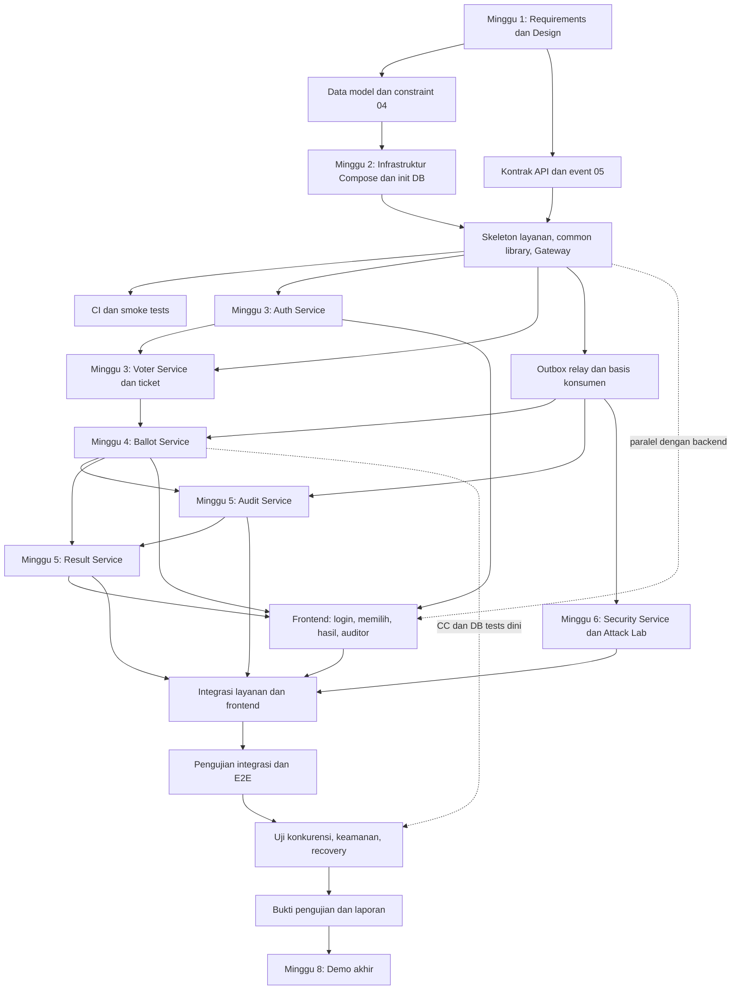

# VoxGuard — Project Plan and Sprint Backlog

## 1. Document Information

| Atribut | Nilai |
|---|---|
| Nama dokumen | Project Plan / Sprint Backlog |
| Proyek | VoxGuard — Verifiable Digital Election System |
| Versi / Status | 0.1 / **Draft — usulan rencana; semua estimasi PROPOSED dan belum dikonfirmasi tim** |
| Tanggal | 2026-10-10 |
| Pemilik | `[PEMILIK-DOKUMEN]` (placeholder) |
| Acuan | `01_PROJECT_CHARTER.md` (milestone), SRS (`02_…`), SAD (`03_…`), `04_…`–`07_…` |

| Versi | Tanggal | Perubahan |
|---|---|---|
| 0.1 | 2026-10-10 | Draf awal |

Rencana ini adalah **baseline**, bukan jaminan bahwa seluruh fitur selesai dalam delapan minggu. Nama anggota tidak dikarang: dipakai placeholder peran `[ANGGOTA-A]`, `[ANGGOTA-B]`, `[ANGGOTA-C]`. Status awal seluruh item: `TODO`. Keputusan jadwal dan pembagian kerja: **OPEN DECISION OD-15, OD-28**.

---

## 2. Planning Assumptions

| ID | Asumsi | Status |
|---|---|---|
| PA-01 | Durasi 8 minggu (satu sprint = satu minggu) | Asumsi — **konfirmasi `[DOSEN-PEMBIMBING]` dan tim** |
| PA-02 | Tim 2–3 orang; kapasitas rata-rata PROPOSED 10–12 jam/orang/minggu | Konfirmasi tiap anggota |
| PA-03 | Backend Python/FastAPI; frontend React/Vite/Tailwind | Ditetapkan (stack) |
| PA-04 | PostgreSQL, RabbitMQ, Redis, Docker Compose di perangkat lokal | Ditetapkan |
| PA-05 | Proyek akademik; fokus prototipe | Ditetapkan |
| PA-06 | Estimasi dalam story points (SP) relatif: 1 ≈ ½ jam–2 jam, 2 ≈ ½ hari, 3 ≈ 1 hari, 5 ≈ 2 hari, 8 ≈ 3 hari kerja (**PROPOSED**; kalibrasi setelah sprint 1–2) | Konfirmasi tim |
| PA-07 | Anggota baru mengenal stack; belum ada kode dan CI | Konfirmasi |
| PA-08 | Dokumen 01–07 dibekukan pada akhir minggu 1 | Usulan |
| PA-09 | Total beban backlog di bawah > kapasitas tim 2 orang; P2 dan sebagian P1 dikorbankan lebih dulu (Bagian 11–12) | Diketahui; konfirmasi |

---

## 3. Product Goal

**Tujuan MVP:** prototipe VoxGuard yang dapat dijalankan lokal dengan Docker Compose, di mana Admin menyiapkan pemilihan, pemilih sah memberi satu suara (aman terhadap request paralel dan retry), audit dicatat dengan hash chain yang dapat diverifikasi, hasil dihitung dan direkonsiliasi lalu difinalisasi, anomali menghasilkan alert, dan skenario serangan terkontrol dapat dijalankan dan didokumentasikan — dengan batas keamanan yang dinyatakan jujur.

**Kapabilitas wajib (P0):** autentikasi + RBAC backend; lifecycle pemilihan; kelayakan pemilih; one person one vote (transaksi + unique + idempotency); penghitungan dan rekonsiliasi benar; verifikasi audit dasar; pengujian kritis (konkurensi, RBAC, privasi, tamper audit).

---

## 4. Work Breakdown Structure

| # | Kelompok | Isi pekerjaan | Rujukan |
|---|---|---|---|
| 1 | Requirements and design | Review dokumen, keputusan terbuka, kontrak API/event, model data | 01–07 |
| 2 | Repository and infrastructure | Repo, Compose, init DB/role, CI, `voxguard_common`, migrasi | SAD 16, `04_…` 10 |
| 3 | Authentication | Auth Service, JWT, refresh, RBAC, lockout | FR-AUTH |
| 4 | Election and eligibility | Voter Service, lifecycle, ticket | FR-ELEC, FR-ELIG |
| 5 | Ballot processing | Ballot Service, idempotency, outbox, receipt | FR-BALL |
| 6 | Audit integrity | Audit Service, hash chain, verify, checkpoint | FR-AUDT |
| 7 | Result calculation | Result Service, rekonsiliasi, finalisasi | FR-RSLT |
| 8 | Security monitoring and Attack Lab | Aturan R-xx, alert, metrik, Lab | FR-SECM |
| 9 | Frontend | UI Voter, Admin, Auditor/Security | FR-UI |
| 10 | Integration | Integrasi FE–BE, event end-to-end, penggantian stub | SAD 9, 11 |
| 11 | Testing | Unit, integrasi, konkurensi, keamanan, pemulihan, E2E, kontrak | `07_…` |
| 12 | Documentation | Setup, API, pembaruan dokumen, laporan uji | — |
| 13 | Demonstration | Skrip demo, data demo, dry run, presentasi | Bagian 14 |

---

## 5. Team Roles and Ownership

Pembagian adalah **usulan** (OD-28). Tag peran dipakai pada backlog: `A`, `B`, `C`.

### 5.1 Tim 2 orang

| Peran | Tanggung jawab utama | Pengujian |
|---|---|---|
| **Anggota A** | Frontend, API Gateway, integrasi, Compose/CI; **diusulkan juga** Auth Service dan Security Service + Attack Lab (agar backend tidak bertumpu pada satu orang) | Uji API/RBAC, E2E, usability, sebagian security |
| **Anggota B** | Backend core: Voter, Ballot, Audit, Result, database/migrasi, outbox, integritas suara | Uji integrasi/DB/konkurensi, sebagian recovery |

Catatan: usulan prompt menempatkan A pada frontend/gateway/integrasi dan B pada backend core/DB/ballot; **Auth, Audit, Result, Security** tidak ditentukan. Usulan di sini menugaskan Auth dan Security ke A (dekat dengan Gateway/JWT dan Attack Lab/integrasi), serta Audit dan Result ke B setelah Ballot core (minggu 5). **Risiko:** B sarat pada minggu 3–5; mitigasi di Bagian 11 (tunda P1 Ballot, minta A mengambil Audit bila frontend inti selesai). **Anti-silo:** *code review silang wajib* untuk jalur voting, audit, dan hasil; *pair session* mingguan; **dokumen handover** per layanan (kontrak, cara menjalankan, keputusan desain) selesai sebelum akhir sprint layanan itu dikerjakan; setiap layanan memiliki *cadangan pemilik* (anggota lain) yang pernah menjalankan test-nya.

### 5.2 Tim 3 orang

| Peran | Tanggung jawab utama |
|---|---|
| **Anggota A** | Frontend, API Gateway, integrasi, Compose/CI |
| **Anggota B** | Auth, Voter, Ballot, database terkait |
| **Anggota C** | Audit, Result, Security, event processing (outbox relay/consumer), pengujian |

**Seluruh anggota** tetap bertanggung jawab atas pengujian integrasi, review silang, dan dokumentasi. Backup owner: A↔B untuk jalur login/voting; B↔C untuk jalur event/audit.

**Peta tag untuk tim 2 orang:** tugas bertag `C` pada backlog dikerjakan oleh **A** (Security, Attack Lab, sebagian pengujian) atau **B** (Audit, Result), sesuai kolom "Catatan 2 orang" pada Bagian 7 bila ada; selainnya `B`→B, `A`→A.

---

## 6. Eight-Week Roadmap

Selaras dengan milestone `01_PROJECT_CHARTER.md` Bagian 9. Ini baseline; bukan jaminan seluruh fitur selesai.

| Minggu | Sprint goal | Pekerjaan utama | Deliverables | Dependency | Acceptance criteria | Risiko | Definition of Done |
|---|---|---|---|---|---|---|---|
| 1 | Requirements and Design | Finalisasi dokumen inti; sepakati data model; tetapkan kontrak; siapkan repo dan aturan kerja | Dokumen 01–08 direview; OD kritis diputuskan; repo dan aturan kerja | — | Tidak ada konflik dokumen; kontrak v1 dibekukan | Dokumen terlalu banyak untuk direview; OD tertunda | Review tim selesai; OD-01/02/11/14/15/28 diputuskan |
| 2 | Infrastructure and Skeleton | Compose, struktur layanan, PostgreSQL (6 DB + role), Gateway, CI, smoke tests | `docker compose up` menyalakan stack sehat; skeleton 6 layanan + Gateway; `voxguard_common`; CI hijau | Sprint 1 | Health semua layanan lewat Gateway; migrasi kosong jalan (MIG-01) | Kendala Docker/jaringan lokal; versi dependency | Smoke test lulus di mesin anggota lain |
| 3 | Authentication and Election | Auth Service, RBAC, Voter Service, pemilihan/kandidat/kelayakan | Endpoint Auth dan Voter; Gateway JWT/RBAC; outbox relay awal; UI login/pemilihan dasar | Sprint 2 | API-AUTH-*, IT-VOT-01..05, DB-01..04/08/09 lulus | Beban B tinggi; kontrak berubah | Test terkait lulus; kontrak tidak menyimpang |
| 4 | Ballot Core | Ballot Service, anti-ganda, idempotency, transaksi, outbox | `POST /ballots`, ballot view, receipt, internal export; UI memilih | Sprint 3 (ticket, ballot-info) | IT-BAL-01..07, CC-01..05, DB-05/06/10 lulus | Race condition lolos; bergantung Voter | Uji konkurensi hijau berulang (bukan sekali) |
| 5 | Audit and Results | Audit Service, hash chain, Result Service, rekonsiliasi, uji integritas awal | Chain + verify + proof + checkpoint; tally + finalize; UI hasil | Sprint 4 (VoteAccepted, export) | IT-AUD-*, SEC-AUD-01..04, IT-RES-01..05 lulus | Canonical JSON tidak deterministik; konsumen salah | `verify` mendeteksi semua modifikasi uji |
| 6 | Security and Integration | Security Service, aturan anomali, Attack Lab, integrasi FE–BE, perbaikan kontrak/event | Alert R-xx, metrik, Lab ATK-01..10 (versi awal), integrasi penuh | Sprint 5 | IT-SEC-01..06; E2E-02 versi awal lulus | Attack Lab terlalu kompleks; integrasi telat | Stub diganti; E2E smoke hijau |
| 7 | Testing and Hardening | Uji konkurensi, keamanan, recovery, E2E; perbaikan defect | Hasil uji aktual tercatat; defect S1/S2 ditutup; hardening konfigurasi | Sprint 6 | AC-01..AC-13 diperiksa; REC-01..06; SEC-* | Waktu uji kurang; defect besar | Tidak ada S1/S2 terbuka |
| 8 | Finalization and Demo | Perbaikan akhir, dokumentasi setup, demo sukses dan serangan, laporan uji, presentasi | Repo siap; panduan instalasi; skrip demo; laporan pengujian; slide | Sprint 7 | Exit criteria `07_…` Bagian 16; AC-11 (uji dari repo bersih) | Demo gagal; dokumen tak sinkron | DoD proyek (Charter 13) terpenuhi |

---

## 7. Sprint Backlog

Kolom: ID | Epic | Task/user story | Pri (P0/P1/P2, Bagian 12) | Owner (tag peran) | Dependency | Acceptance criteria | Est (SP, **PROPOSED**) | Status. Semua status awal `TODO`. "Test" merujuk ID di `07_…` (PLANNED).

### Sprint 1 — Requirements and Design

| ID | Epic | Task | Pri | Owner | Dep | Acceptance | Est | Status |
|---|---|---|---|---|---|---|---|---|
| VG-S1-001 | Design | Review dokumen 01–08; putuskan OD kritis (OD-01, 02, 11, 14, 15, 28) | P0 | A,B,C | — | Keputusan tercatat per OD; dosen dikonsultasi untuk OD-11/15/17 | 3 | TODO |
| VG-S1-002 | Design | Rekonsiliasi konflik dokumen (envelope `producer`, ID test/AC, pembagian tim, penomoran FR) | P0 | A,B | S1-001 | SAD 11.1, `API_CONTRACTS.md`, SRS 14, Charter 12 diperbarui; daftar konflik kosong | 3 | TODO |
| VG-S1-003 | Design | Review data model dan constraint (`04_…`) | P0 | B | S1-001 | DBC-01..15 disetujui pemilik layanan | 2 | TODO |
| VG-S1-004 | Design | Bekukan kontrak API/event v1 (`05_…`); draf OpenAPI | P0 | A,B | S1-001 | Kontrak tidak berubah tanpa PR + review pemilik terdampak | 3 | TODO |
| VG-S1-005 | Repo | Struktur repository, branch/PR/review, lint/format, template PR | P0 | A | — | Repo terstruktur; aturan review (minimal 1 reviewer) aktif | 2 | TODO |
| VG-S1-006 | Repo | Kebijakan secret: `.env.example` placeholder, `.gitignore`, aturan tidak commit secret | P0 | A | — | Tidak ada secret di repo; SEC-CFG-01 direncanakan | 1 | TODO |
| VG-S1-007 | Repo | Pin versi dependency (OD-19) | P1 | A | — | File dependency dengan versi tetap | 1 | TODO |
| VG-S1-008 | Test | Tetapkan konvensi test (struktur folder, marker, seed sintetis) | P1 | C | S1-001 | Template test + seed deterministik disetujui | 2 | TODO |

### Sprint 2 — Infrastructure and Skeleton

| ID | Epic | Task | Pri | Owner | Dep | Acceptance | Est | Status |
|---|---|---|---|---|---|---|---|---|
| VG-S2-001 | Infra | Docker Compose: postgres, rabbitmq, redis + healthcheck, jaringan `voxguard-net`, volume | P0 | A | S1-005 | Stack infrastruktur sehat; hanya Gateway/frontend dipublikasikan (SEC-CFG-02 direncanakan) | 3 | TODO |
| VG-S2-002 | Infra | Init PostgreSQL: 6 database + 6 role hak minimum | P0 | B | S2-001 | Setiap role hanya mengakses databasenya (IT-ARCH-01 awal) | 3 | TODO |
| VG-S2-003 | Skeleton | Skeleton 6 layanan FastAPI: config, logging JSON, `/health/live`, `/health/ready` | P0 | B,C | S2-001 | Health hijau; log JSON dengan `request_id` | 5 | TODO |
| VG-S2-004 | Common | `voxguard_common`: format error, middleware request/correlation ID, canonical JSON, util hash, envelope event | P0 | B | S1-004 | UT-HASH-01 awal lulus; kode bebas logika domain | 5 | TODO |
| VG-S2-005 | Gateway | Routing `/api/v1/*`, request/correlation ID, error format seragam, CORS | P0 | A | S2-003, S2-004 | Request ID di respons; routing sesuai tabel SAD 6 | 5 | TODO |
| VG-S2-006 | DB | Alembic per layanan (env + revisi awal) | P0 | B,C | S2-002 | MIG-01 lulus untuk semua layanan | 3 | TODO |
| VG-S2-007 | CI | CI: lint, pytest, smoke compose | P1 | A | S2-003 | Pipeline hijau pada PR | 3 | TODO |
| VG-S2-008 | Test | Smoke test health semua layanan lewat Gateway | P0 | C | S2-005 | Test lulus di dua mesin | 2 | TODO |
| VG-S2-009 | CI | Pemindaian secret di CI | P1 | A | S2-007 | SEC-CFG-01 otomatis | 2 | TODO |
| VG-S2-010 | Frontend | Skeleton Vite+Tailwind, routing per role, klien API | P1 | A | S2-005 | Halaman dasar tampil lewat Gateway | 3 | TODO |

### Sprint 3 — Authentication and Election

| ID | Epic | Task | Pri | Owner | Dep | Acceptance | Est | Status |
|---|---|---|---|---|---|---|---|---|
| VG-S3-001 | Auth | users, register, login, Argon2id (FR-AUTH-001/002) | P0 | B | S2-006 | API-AUTH-01..03, UT-AUTH-01 lulus | 5 | TODO |
| VG-S3-002 | Auth | refresh rotasi + deteksi reuse, logout + denylist, `me` | P0 | B | S3-001 | API-AUTH-04..06 lulus | 5 | TODO |
| VG-S3-003 | Gateway | Validasi JWT, RBAC rute, header identitas dan pembuangan header klien, rate limit Redis | P0 | A | S3-001 | API-AUTH-08, API-RBAC-01 (awal), API-RL-01 lulus | 5 | TODO |
| VG-S3-004 | Auth | Lockout + sinyal keamanan | P1 | B | S3-001 | API-AUTH-07 lulus | 2 | TODO |
| VG-S3-005 | Voter | Model + migrasi elections/candidates/voters/voting_eligibility + constraint | P0 | B | S2-006 | DB-02..04, DB-08, DB-09 lulus | 5 | TODO |
| VG-S3-006 | Voter | Endpoint buat/daftar/detail, kandidat, impor pemilih, `schedule` (pembekuan) | P0 | B | S3-005 | IT-VOT-01..03 lulus | 8 | TODO |
| VG-S3-007 | Voter | `open`/`close` + outbox `ElectionOpened/Closed` | P0 | B | S3-006, S3-011 | IT-VOT-03 lulus; event di outbox | 3 | TODO |
| VG-S3-008 | Voter | API internal `ballot-info`, `eligibility/tickets`, `summary` | P0 | B | S3-006 | IT-VOT-04/05 lulus; ticket tanpa identitas | 5 | TODO |
| VG-S3-009 | Test | Uji API/integrasi sprint ini | P0 | C | S3-001..008 | Test sprint hijau | 5 | TODO |
| VG-S3-010 | Frontend | Login, daftar pemilihan, admin buat pemilihan (boleh stub terdokumentasi) | P0 | A | S3-003 | Alur login dan buat pemilihan jalan | 5 | TODO |
| VG-S3-011 | Event | Outbox relay generik + basis konsumen (`processed_events`, retry bertingkat, DLQ) | P0 | C | S2-004 | IT-OUT-01 lulus | 8 | TODO |

### Sprint 4 — Ballot Core

| ID | Epic | Task | Pri | Owner | Dep | Acceptance | Est | Status |
|---|---|---|---|---|---|---|---|---|
| VG-S4-001 | Ballot | Model + migrasi ballots, idempotency_records, outbox, election_gates + constraint/trigger | P0 | B | S3-011 | DB-05, DB-06, DB-10, SEC-DB-01 lulus | 5 | TODO |
| VG-S4-002 | Ballot | `GET /elections/{id}/ballot` (ticket via Voter) | P0 | B | S3-008 | API-BAL-01 lulus | 3 | TODO |
| VG-S4-003 | Ballot | `POST /ballots`: transaksi idempotency + UNIQUE + outbox; response replay | P0 | B | S4-001, S4-002 | IT-BAL-01..05, API-BAL-02/03 lulus | 8 | TODO |
| VG-S4-004 | Ballot | Cek status fail-closed + gate (`ElectionOpened/Closed`) | P0 | B | S4-003 | IT-BAL-06/07 lulus | 3 | TODO |
| VG-S4-005 | Ballot | Receipt (kode HMAC) + lookup | P0 | B | S4-003 | API-BAL-04 lulus | 3 | TODO |
| VG-S4-006 | Ballot | `VoteRejected` outbox + `client_fingerprint` | P1 | B | S4-003 | Event penolakan muncul tanpa identitas/pilihan | 3 | TODO |
| VG-S4-007 | Ballot | API internal `tally-export`, `summary`, `outbox/stats` | P0 | B | S4-003 | Ekspor tanpa `eligibility_ref`; digest dihitung | 3 | TODO |
| VG-S4-008 | Voter | Konsumsi `VoteAccepted` → status `VOTED` | P0 | B | S4-003, S3-011 | Idempoten; IT-BAL-02 sisi Voter | 3 | TODO |
| VG-S4-009 | Test | CC-01..05, IT-BAL-*, API-BAL-*, DB-05/06/10 | P0 | C | S4-003 | Seluruh hijau, **dijalankan berulang** (≥ 10 kali) | 8 | TODO |
| VG-S4-010 | Frontend | Ballot view, memilih, receipt | P0 | A | S4-002, S4-003 | E2E-01 awal | 5 | TODO |

### Sprint 5 — Audit and Results

| ID | Epic | Task | Pri | Owner | Dep | Acceptance | Est | Status |
|---|---|---|---|---|---|---|---|---|
| VG-S5-001 | Audit | Konsumsi event, proyeksi allowlist, hash chain, `audit_chain_heads` | P0 | C | S3-011, S4-003 | IT-AUD-01/02, UT-HASH-01/02 lulus | 8 | TODO |
| VG-S5-002 | Audit | `verify`, `proof`, daftar events, `integrity_checks` | P0 | C | S5-001 | IT-AUD-03, SEC-AUD-01..03 lulus | 5 | TODO |
| VG-S5-003 | Audit | Checkpoint ber-HMAC ke volume terpisah | P1 | C | S5-001 | SEC-AUD-04 lulus | 3 | TODO |
| VG-S5-004 | Audit/Ballot | `AuditRecorded` → `audit_acks` → receipt `RECORDED` | P0 | B,C | S5-001, S4-005 | E2E-01 menunjukkan `PENDING`→`RECORDED` | 3 | TODO |
| VG-S5-005 | Result | Tally dari ekspor, commitment, rekonsiliasi B/A/V | P0 | C | S4-007, S5-002 | IT-RES-01/02/04, UT-COMMIT-01 lulus | 8 | TODO |
| VG-S5-006 | Result | Finalisasi: verifikasi audit, `final_results` immutable, `ResultFinalized`; Voter → `FINALIZED` | P0 | C | S5-005 | IT-RES-03/05, DB-12 lulus | 5 | TODO |
| VG-S5-007 | Result | `GET` hasil, `verify`, aturan akses | P0 | C | S5-006 | ATK-04 (awal), IT-RES-* lulus | 3 | TODO |
| VG-S5-008 | Test | IT-AUD-*, SEC-AUD-*, IT-RES-*, DB-11..13/15 | P0 | C | S5-001..007 | Hijau | 5 | TODO |
| VG-S5-009 | Frontend | Halaman hasil; admin tally/finalize | P1 | A | S5-007 | Alur admin selesai | 5 | TODO |
| VG-S5-010 | Audit | Outbox + sinyal `AUDIT_INTEGRITY_FAILED` | P1 | C | S5-002 | Sinyal terkirim saat `INVALID` | 2 | TODO |

*Catatan 2 orang:* S5-001..008 dikerjakan oleh B (Audit, Result); S5-009 oleh A; S5-004 bersama.

### Sprint 6 — Security and Integration

| ID | Epic | Task | Pri | Owner | Dep | Acceptance | Est | Status |
|---|---|---|---|---|---|---|---|---|
| VG-S6-001 | Security | Konsumsi event, `security_events` dedup, aturan R-01..R-10 | P1 | C | S3-011 | UT-ANOM-01..10, IT-SEC-01..03/06 lulus | 8 | TODO |
| VG-S6-002 | Security | Endpoint alerts dan metrics; polling outbox/DLQ | P1 | C | S6-001 | IT-SEC-04/05; API-RBAC-01 untuk endpoint Security | 5 | TODO |
| VG-S6-003 | Security | Runner Attack Lab + guard (`ATTACK_LAB_ENABLED`, `APP_ENV`, `is_attack_lab`) + `attack_runs` | P1 | C | S6-002 | SEC-LAB-01, SEC-CFG-03 lulus | 5 | TODO |
| VG-S6-004 | Security | Skenario ATK-01..05 | P1 | C | S6-003 | Hasil expected vs actual tercatat | 5 | TODO |
| VG-S6-005 | Security | Skenario ATK-06..10 + endpoint uji audit (terkunci) | P1 | C | S6-003, S5-002 | Hasil tercatat | 5 | TODO |
| VG-S6-006 | Integration | Integrasi FE–BE penuh; ganti stub/mock (catat dan hapus) | P0 | A | S4-010, S5-009 | Tidak ada stub tersisa; daftar stub kosong | 5 | TODO |
| VG-S6-007 | Security | Sinyal Gateway dan Auth (best-effort) | P1 | A,B | S6-001 | Sinyal muncul sebagai `security_events` | 3 | TODO |
| VG-S6-008 | Integration | Review kontrak dan event; perbaiki selisih | P0 | A,B,C | — | Daftar selisih ditutup; dokumen diperbarui | 3 | TODO |
| VG-S6-009 | Frontend | Halaman Auditor/Security (verify, proof, alert, metrik, Attack Lab) | P1 | A | S6-002 | Auditor tanpa kontrol tulis | 5 | TODO |
| VG-S6-010 | Test | E2E-02 smoke (pertama) | P0 | A,B,C | S6-006 | Alur sukses end-to-end berjalan | 3 | TODO |

*Catatan 2 orang:* S6-001..005 dikerjakan A (Security); S6-007 bersama.

### Sprint 7 — Testing and Hardening

| ID | Epic | Task | Pri | Owner | Dep | Acceptance | Est | Status |
|---|---|---|---|---|---|---|---|---|
| VG-S7-001 | Test | Jalankan CC-01..05 berulang; perbaiki | P0 | C,B | S6-010 | Tidak ada pelanggaran satu suara per kelayakan | 5 | TODO |
| VG-S7-002 | Test | SEC-AUD, SEC-DB, SEC-PRV, SEC-INJ, SEC-TKN, SEC-ADM, SEC-EVT | P0 | C | S6-010 | Hasil aktual tercatat | 8 | TODO |
| VG-S7-003 | Test | REC-01..06 | P0 | C | S6-010 | Hasil aktual tercatat; recovery sesuai rancangan | 5 | TODO |
| VG-S7-004 | Test | Jalankan ATK-01..10 | P1 | C | S6-005 | Hasil aktual tercatat di `07_…` Bagian 15 | 5 | TODO |
| VG-S7-005 | Test | E2E-01..04 | P0 | A | S6-010 | Hasil tercatat | 5 | TODO |
| VG-S7-006 | Test | DB-01..15, MIG-01..04 | P0 | B | S6-010 | Hasil tercatat | 3 | TODO |
| VG-S7-007 | Test | CT-01..05, API-VAL, API-RL, API-RBAC-01 lengkap | P1 | A | S6-008 | Kontrak tervalidasi OpenAPI | 5 | TODO |
| VG-S7-008 | Defect | Perbaikan defect S1/S2 + test regresi | P0 | semua | S7-001..007 | Tidak ada S1/S2 terbuka | 8 | TODO |
| VG-S7-009 | Hardening | Periksa port, secret, role DB, endpoint uji, log bersih | P0 | A,B | — | SEC-CFG-01..03, SEC-PRV-02 lulus | 3 | TODO |
| VG-S7-010 | Test | PERF-01..04 (pengamatan) | P2 | C | S6-010 | Angka dicatat dengan konteks perangkat | 3 | TODO |
| VG-S7-011 | Test | UX-01..04 | P2 | A | S6-009 | Hasil tercatat | 2 | TODO |

### Sprint 8 — Finalization and Demo

| ID | Epic | Task | Pri | Owner | Dep | Acceptance | Est | Status |
|---|---|---|---|---|---|---|---|---|
| VG-S8-001 | Defect | Perbaikan akhir defect S3+ yang disepakati | P0 | semua | S7-008 | Daftar defect terbuka disetujui | 5 | TODO |
| VG-S8-002 | Docs | Panduan instalasi dan menjalankan test; **uji dari repo bersih oleh anggota lain** (AC-11) | P0 | A | S7-009 | Anggota lain berhasil mengikuti panduan | 3 | TODO |
| VG-S8-003 | Docs | Laporan pengujian (`07_…` Bagian 15) berisi hasil aktual dan bukti | P0 | C | S7-001..006 | Laporan terisi; AC-01..13 berstatus berdasar bukti | 3 | TODO |
| VG-S8-004 | Demo | Skrip demo + data demo sintetis (Bagian 14) | P0 | A,B | S7-005 | Skrip dapat dijalankan ulang | 3 | TODO |
| VG-S8-005 | Demo | Dry run demo minimal dua kali; cadangan rekaman | P0 | semua | S8-004 | Dua run berhasil | 3 | TODO |
| VG-S8-006 | Docs | Perbarui dokumen 01–07 (status rancangan→diimplementasikan/diuji hanya bila ada bukti) | P0 | semua | S7-008 | Dokumen sesuai realita | 5 | TODO |
| VG-S8-007 | Demo | Presentasi/slide | P1 | semua | S8-005 | Slide siap | 3 | TODO |
| VG-S8-008 | Docs | Handover dokumen per layanan dan retrospektif | P1 | semua | — | Catatan handover tersedia | 2 | TODO |

---

## 8. Dependency Graph

**Dapat paralel:** (a) Auth dan Voter (Auth lebih dulu hanya untuk JWT pada Gateway); (b) Frontend dengan backend setelah skeleton + kontrak (menggunakan stub terdokumentasi sementara); (c) Audit, Result, dan Security setelah Ballot menghasilkan event (Audit dan Security berbagi basis konsumen); (d) pengujian DB/konkurensi dimulai segera setelah Ballot core, bukan menunggu seluruh sistem.

---

## 9. Critical Path and Integration Strategy

**Jalur kritis:** Kontrak API/event (S1-004) → skeleton layanan + `voxguard_common` (S2-003/004) → Auth/Gateway JWT (S3-001..003) → Voter + ticket (S3-006/008) → outbox/konsumen (S3-011) → Ballot `POST /ballots` (S4-003) → Audit chain (S5-001) → Result rekonsiliasi + finalisasi (S5-005/006) → integrasi (S6-006/010) → uji konkurensi/keamanan/recovery (S7) → laporan dan demo (S8). Keterlambatan pada S3-011 (outbox/konsumen) atau S4-003 menunda semuanya.

Strategi integrasi (wajib):

1. **Kontrak API dan event disepakati sebelum implementasi paralel** (S1-004); perubahan lewat PR dokumen + review pemilik terdampak.
2. **Setiap layanan menyediakan `/health/live|ready` dan smoke test** sejak sprint 2 (S2-003/008).
3. **Integrasi dimulai sejak skeleton tersedia**; setiap sprint diakhiri dengan demo integrasi kecil (login via Gateway di minggu 3, voting di minggu 4, dst.).
4. **Stub/mock hanya sementara:** setiap stub dicatat (lokasi, alasan, sprint target penggantian) pada daftar stub; semua stub **harus diganti sebelum S6-006 selesai** (minggu 6).
5. **Tidak menunggu semua layanan selesai** untuk mulai integration test: IT/DB/CC ditulis bersama layanan (S3-009, S4-009, S5-008).
6. **Review kontrak API dan event berkala:** minimal sekali per sprint (S6-008 adalah sesi penutup), mencocokkan OpenAPI, event schema, dan `05_…`.
7. Uji konkurensi dijalankan berulang (CI nightly bila tersedia) karena race condition tidak selalu muncul pada satu kali run.

---

## 10. Definition of Ready and Definition of Done

**Definition of Ready (task siap dikerjakan):**
1. Acceptance criteria jelas dan dapat diuji; test ID terkait dicantumkan.
2. Dependency teknis selesai atau ada stub yang dicatat.
3. Kontrak API/event/tabel terkait sudah disepakati.
4. Owner dan reviewer ditentukan; estimasi diberikan (PROPOSED).
5. Data uji sintetis dan lingkungan tersedia.

**Definition of Done (task selesai):**
1. Kode memenuhi acceptance criteria dan kontrak `05_…`.
2. **Code review** oleh anggota lain disetujui (jalur voting/audit/hasil wajib reviewer yang bukan penulis).
3. **Test evidence:** test terkait ditulis dan lulus; bukti (log run, query) disimpan; status test di `07_…` diperbarui hanya sesuai bukti.
4. **Dokumentasi:** kontrak/skema/OD terkait diperbarui; README layanan (cara menjalankan) mutakhir.
5. **Integrasi:** layanan berjalan di Compose dan lolos smoke test; tidak merusak layanan lain.
6. Tidak ada secret/data pribadi/`candidate_id` di log, event, atau repo.
7. Tidak ada defect S1/S2 terbuka untuk task tersebut; stub diganti atau dicatat.

---

## 11. Risk and Contingency Plan

| Risiko | Gejala dini | Kontingensi | Boleh ditunda | **Tidak boleh dikorbankan** |
|---|---|---|---|---|
| Anggota tim terlambat/berhalangan | Item sprint tidak bergerak 3 hari | Pindahkan item P0 ke backup owner; potong P1/P2 | Fitur P1/P2 pemilik tersebut | Jalur voting, otorisasi, penghitungan |
| Integrasi gagal | E2E smoke merah setelah sprint 6 | Fokus alur P0 saja; perbaiki kontrak; sesi integrasi bersama | UI Auditor/Security | Alur: login → memilih → tally → finalisasi |
| Dependency service tertunda | Layanan hilir menunggu | Stub terdokumentasi + tanggal penggantian; kerjakan paralel | Fitur hilir non-P0 | Kontrak tetap |
| Scope membesar | Item baru di luar backlog | Hanya ADD- setelah P0 hijau; keputusan tertulis | Semua ADD-xx | Scope P0 |
| Race condition belum terselesaikan | CC gagal sesekali | Hentikan fitur baru di jalur voting; analisis transaksi; tambah test deterministik | Optimasi performa | UNIQUE + transaksi + idempotency |
| Hasil tidak dapat direkonsiliasi | `RECONCILIATION_FAILED` persisten | Telusuri outbox/event/commitment; tally ulang; tolak finalisasi | Dashboard hasil | Aturan: tidak finalisasi tanpa MATCH |
| Attack Lab terlalu kompleks | ATK baru belum jalan di akhir minggu 6 | Jalankan skenario manual berskrip (pytest) dan dokumentasikan; kurangi varian | Runner otomatis penuh, varian ATK-02 B/C | Guard Lab; ATK-01/02/05/06 minimal |
| Waktu pengujian kurang | S7 tertinggal | Prioritaskan Must: CC, RBAC, SEC-PRV, SEC-AUD, IT-RES, E2E-02; tunda PERF/UX/CT Should | PERF, UX, CT-02/03/05 | Uji konkurensi, privasi, RBAC, audit tamper |
| Beban B terlalu besar (tim 2 orang) | Sprint 3–5 berlebih | A mengambil Audit; tunda `VoteRejected`, checkpoint, `voter_code` | P1 Ballot/Audit tambahan | Ballot core, rekonsiliasi |

---

## 12. MVP Prioritization

| Prioritas | Isi | Item backlog (contoh) |
|---|---|---|
| **P0 — wajib demo utama** | Autentikasi + otorisasi backend; lifecycle pemilihan; kelayakan pemilih; one person one vote; penghitungan benar + rekonsiliasi; audit verification dasar; pengujian kritis | S3-001..003/005..009; S4-001..005/007..010; S5-001/002/005..008; S6-006/008/010; S7-001/002/005/006/008/009 |
| **P1 — penting** | Transactional outbox + retry/recovery; anomaly alerts; Attack Lab terkontrol; checkpoint audit | S3-011; S5-003/010; S6-001..005/007/009; S7-003/004/007 |
| **P2 — lanjutan** | Optimasi skala besar; dashboard observability lanjutan; hardening produksi | S7-010/011; ADD-xx; TLS/vault/mTLS (SAD 20) |

*Catatan:* outbox dasar tetap diperlukan agar Audit/Result berfungsi; yang P1 adalah kelengkapannya (retry/DLQ/pemulihan terotomasi dan uji recovery). Kontrol inti — anti-suara-ganda, otorisasi backend, privasi dasar, validitas penghitungan — **tidak boleh** dikorbankan demi tampilan demo.

---

## 13. Progress Tracking

| Metrik | Cara ukur | Frekuensi |
|---|---|---|
| Task completion | SP/jumlah item `DONE` vs rencana per sprint (burndown sederhana) | Mingguan |
| Acceptance criteria passed | Jumlah AC-01..13 berstatus `MET` (dengan bukti) | Per sprint ≥ 3 |
| Defect terbuka | Jumlah per severity (S1–S4) | Mingguan |
| Test coverage | Sebagai **indikator pendukung** (mis. persen baris pada modul inti: ballot, audit, result); bukan target tunggal | Per sprint |
| Integrasi layanan berhasil | Jumlah jalur integrasi hijau (Gateway↔tiap layanan, Ballot↔Voter, event Ballot→Audit/Voter/Security, Result↔Ballot/Audit/Voter) | Per sprint |
| Risiko belum ditangani | Jumlah risiko Bagian 11 tanpa mitigasi berjalan | Mingguan |
| Test kritis hijau | Jumlah test Must (CC, SEC-AUD, IT-RES, API-RBAC) lulus berturut-turut | Per sprint |

Cakupan kode bukan satu-satunya ukuran kualitas; kualitas dinilai dari AC terbukti, defect S1/S2 nol, dan test kritis yang konsisten hijau. Rapat singkat mingguan (planning/review/retro) mencatat progres dan risiko.

---

## 14. Demo and Final Deliverables

**Skenario demo (hanya pada sistem sendiri, data sintetis):**

| # | Langkah | Bukti |
|---|---|---|
| 1 | Admin membuat pemilihan, kandidat, impor pemilih, schedule, open | UI/API; event audit |
| 2 | Pemilih sah login dan memberi suara; receipt ditampilkan tanpa pilihan | Receipt `PENDING`→`RECORDED` |
| 3 | Sistem menolak suara ganda | `409 VOTER_ALREADY_VOTED` (ATK-01) |
| 4 | Percobaan paralel (50 request) tidak melanggar aturan | Satu baris `ballots` (ATK-02/CC-01) |
| 5 | Audit verification berjalan | `verify` `VALID` + proof |
| 6 | Tutup pemilihan; tally dan rekonsiliasi `MATCH`; finalisasi; verifikasi hasil | `final_results`, `verify` `MATCH` |
| 7 | Simulasi manipulasi pada **data uji** (DB uji/election lab) terdeteksi | `verify` `INVALID` (ATK-06) |
| 8 | Anomaly alert muncul | Alert R-01/R-02 (ATK-01/02) |
| 9 | Dokumentasi dan pengujian dapat dijalankan ulang | Panduan + satu perintah test; laporan hasil `07_…` Bagian 15 |

Demo **tidak** menyerang sistem atau pihak eksternal; Attack Lab hanya pada lingkungan lokal/uji dan election lab. Hasil yang ditampilkan adalah hasil aktual; tidak ada angka yang dikarang.

**Deliverables akhir:** repository (kode 7 komponen + frontend), Compose, panduan instalasi/test, test suite, Attack Lab, OpenAPI, dokumen 01–08 mutakhir, laporan pengujian, slide demo.

---

## 15. Konflik dan Keputusan Terbuka

| ID | Catatan | Penyelesaian yang disarankan |
|---|---|---|
| C-PLAN-01 | `01_PROJECT_CHARTER.md` Bagian 12 membagi komponen berbeda (mis. tim 2 orang: Anggota-1 memegang gateway, auth, voter, ballot; Anggota-2 audit, result, security, frontend) dari usulan Bagian 5 dokumen ini | Pakai pembagian dokumen ini (mengikuti prompt perencanaan) lalu perbarui Charter 12 (S1-002); keputusan akhir OD-28 |
| OD-15 | Jadwal 8 minggu dan estimasi | Tinjau dan kalibrasi di akhir sprint 2 |
| OD-28 | Pembagian kerja tim 2 dan 3 orang | Usulan Bagian 5 |
| OD-29 | Kapasitas jam per orang per minggu (PA-02) | Konfirmasi di minggu 1 |
| Lainnya | OD-01, 02, 07, 11, 12, 13, 14, 16, 17, 19, 20 | Lihat Charter 14 dan SRS 17 |

Rujukan: `04_…` (data), `05_…` (kontrak), `06_…` (ancaman), `07_…` (pengujian).
