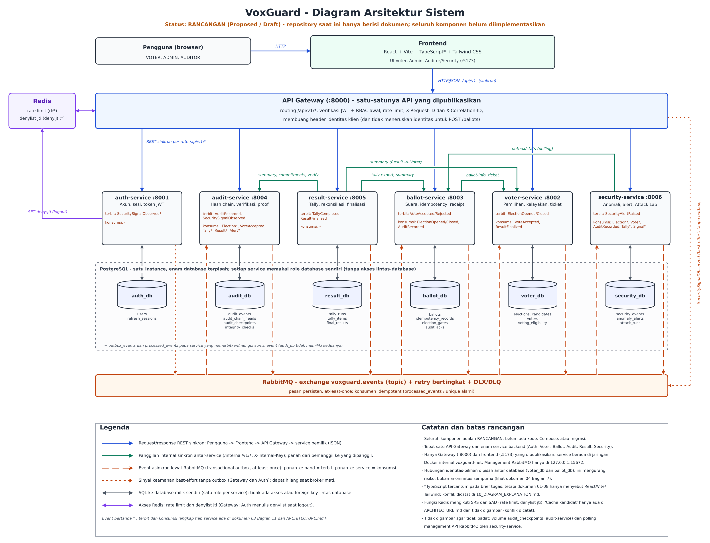
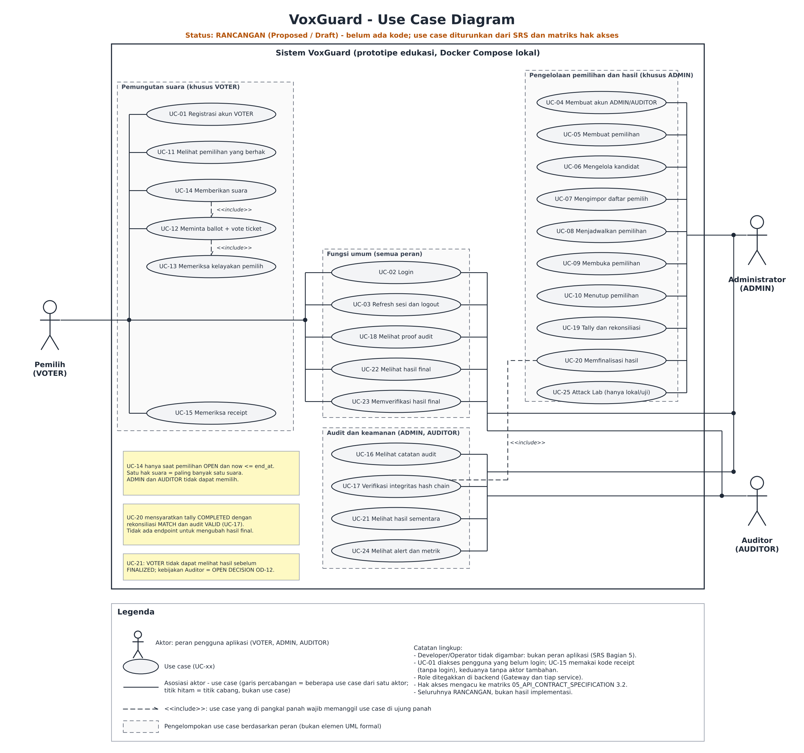
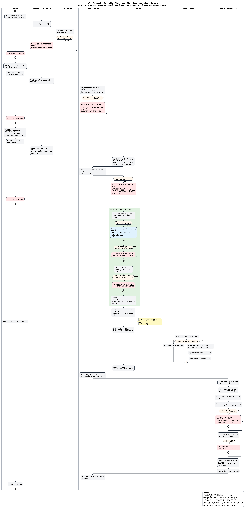
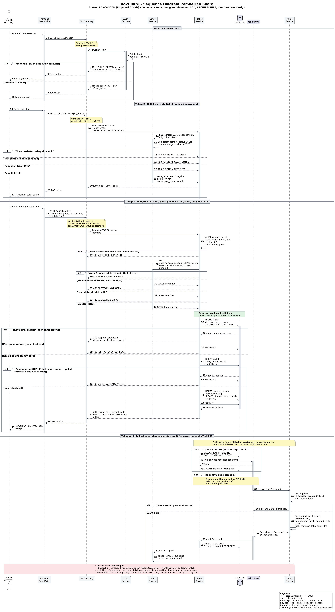
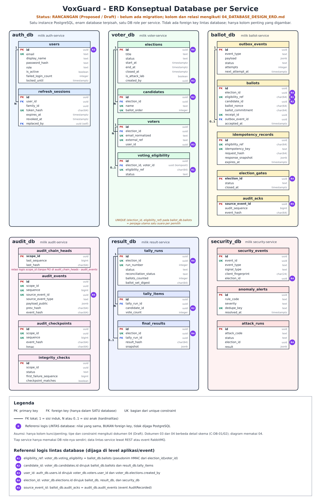

# 10 - Penjelasan Diagram Visual VoxGuard

**Status:** RANCANGAN (Proposed / Draft). Repositori ini baru berisi dokumen; belum ada kode, migration, atau hasil uji. Semua diagram menggambarkan desain yang *direncanakan*, bukan sistem yang sudah berjalan, dan tidak membuktikan bahwa sistem aman, anonim sempurna, atau tahan serangan.

**Sumber otoritatif (urutan prioritas):** seri dokumen 01-08 (SRS, SAD, Database Design, API Contract), lalu `ARCHITECTURE.md`, `PROJECT_BRIEF.md`, `API_CONTRACTS.md`, `SECURITY_AND_TEST_PLAN.md`. Jika berbeda, diagram mengikuti seri 01-08 dan konflik dicatat di Bagian 7.

Seluruh file gambar ada di `docs/diagrams/`; sumber (dapat dirender ulang) ada di `docs/diagrams/source/`.

---

## 1. System Architecture



- **Tujuan:** menunjukkan komponen, batas kepemilikan data, dan jenis komunikasi (sinkron vs asinkron).
- **Berkas:** `diagrams/01_system_architecture.png` (3200x2450); sumber `diagrams/source/01_system_architecture.py`.
- **Komponen:** frontend React + Vite + Tailwind (:5173); satu API Gateway (:8000); enam service (Auth :8001, Voter :8002, Ballot :8003, Audit :8004, Result :8005, Security :8006); satu instance PostgreSQL berisi enam database (auth_db, voter_db, ballot_db, audit_db, result_db, security_db), satu DB role per service; RabbitMQ (exchange `voxguard.events`); Redis (rate limit `rl:*`, denylist `deny:jti:*`).
- **Arti panah:** biru = REST sinkron dari klien/gateway; hijau = REST sinkron internal antarservice (mis. Ballot -> Voter untuk status pemilihan, Result -> Ballot/Audit/Voter); oranye putus-putus = event asinkron via RabbitMQ (publish ke bawah, consume ke atas); oranye titik-titik = sinyal best-effort ke Security Service; ungu = akses Redis; abu-abu = SQL ke database milik sendiri.
- **Urutan proses:** bukan urutan waktu; lihat Diagram 3 dan 4 untuk alur.
- **Hubungan dengan dokumen:** SAD Bagian 3-8, SRS Bagian 5-8. Tidak ada panah dari service ke database service lain (tidak ada shared DB).
- **Batas/asumsi:** semua komponen berstatus *Proposed*. Volume `audit_checkpoints` terpisah dan polling manajemen RabbitMQ oleh Security tidak digambar (disebut pada catatan gambar).

## 2. Use Case



- **Tujuan:** fungsi sistem per peran aplikasi.
- **Berkas:** `diagrams/02_use_case.png` (2740x2570); sumber `diagrams/source/02_use_case.py`.
- **Aktor:** VOTER, ADMIN, AUDITOR (SRS Bagian 5). Developer/Operator tidak digambar karena bukan peran aplikasi. Tidak ada aktor tambahan.
- **Use case:** UC-01..UC-25, dikelompokkan visual (bukan elemen UML formal) menurut peran. System boundary = Sistem VoxGuard.
- **Arti garis:** garis solid = asosiasi aktor-use case (titik hitam = percabangan, bukan use case); panah putus-putus `<<include>>`: UC-14 -> UC-12 -> UC-13, dan UC-20 -> UC-17.
- **Hubungan dokumen:** SRS Bagian 5 dan 8; matriks hak akses `05_API_CONTRACT_SPECIFICATION.md` 3.2.
- **Batas/asumsi:** hubungan `include` lain tidak digambar karena tidak ada dasar di dokumen. UC-01 (registrasi) dan UC-15 (receipt) dapat diakses tanpa login. Kebijakan Auditor melihat hasil sementara (UC-21) adalah OPEN DECISION OD-12.

## 3. Activity Diagram Alur Pemungutan Suara



- **Tujuan:** alur end-to-end dari login hingga hasil final, termasuk jalur gagal.
- **Berkas:** `diagrams/03_voting_activity.png` (4449x9173); sumber `diagrams/source/03_voting_activity.puml`.
- **Pelaku (swimlane):** Pemilih; Frontend + API Gateway; Auth, Voter, Ballot, Audit Service; Admin / Result Service.
- **Arti simbol:** belah ketupat = keputusan; kotak merah muda = penolakan; kotak hijau = satu transaksi lokal `ballot_db`.
- **Urutan:** login -> kelayakan -> vote ticket berpseudonim -> pilih kandidat -> kirim `POST /ballots` dengan Idempotency-Key -> validasi -> transaksi lokal (idempotency, ballots, outbox, COMMIT) -> receipt PENDING -> relay outbox publish -> Audit append hash chain -> receipt RECORDED -> pemilih ditandai VOTED -> CLOSED -> tally -> rekonsiliasi -> verifikasi audit -> finalisasi.
- **Keputusan gagal:** kredensial ditolak/terkunci; tidak layak (403/409); pemilihan tidak OPEN; ticket/validasi gagal; Voter Service tidak tersedia (503, fail-closed); retry idempotent vs konflik; pelanggaran UNIQUE (suara ganda); event duplikat; rekonsiliasi tidak MATCH; audit tidak VALID.
- **Privasi:** catatan audit memakai proyeksi allowlist tanpa identitas, `candidate_id`, atau `eligibility_ref`. Pseudonim `eligibility_ref` mengurangi risiko pengaitan identitas-pilihan, **bukan** anonimitas sempurna.
- **Batas:** tally hanya saat CLOSED; hash chain mendeteksi, tidak mencegah, manipulasi.

## 4. Sequence Diagram Pemungutan Suara



- **Tujuan:** urutan pesan antarkomponen pada alur voting.
- **Berkas:** `diagrams/04_voting_sequence.png` (4186x7641); sumber `diagrams/source/04_voting_sequence.puml`.
- **Partisipan:** Pemilih, Frontend, API Gateway, Auth, Voter, Ballot, ballot_db, RabbitMQ, Audit.
- **Arti panah:** panah solid = pemanggilan sinkron; putus-putus = respons; panah ke RabbitMQ/Audit = event asinkron. Bar aktivasi menunjukkan masa pemrosesan; `alt`/`opt` untuk cabang gagal dan kondisi RabbitMQ tidak tersedia.
- **Poin utama:** transaksi lokal ballot_db (idempotency -> ballots -> outbox -> COMMIT) **tidak atomik** dengan RabbitMQ; publikasi event terjadi *setelah* commit oleh relay outbox (at-least-once, publisher confirms), konsumen idempoten.
- **Result Service tidak digambar** pada sequence ini; catatan pada gambar menegaskan tally baru berjalan setelah CLOSED (lihat Diagram 3).
- **Batas:** receipt PENDING -> RECORDED berarti tercatat, bukan terverifikasi.

## 5. Database ERD (per service)



- **Tujuan:** struktur data dan batas kepemilikan database-per-service.
- **Berkas:** `diagrams/05_database_erd.png` (2100x3280); sumber `diagrams/source/05_database_erd.py`.
- **Komponen:** enam kotak database, masing-masing dengan tabel pentingnya (PK/FK/UK, tipe).
- **Arti garis:** garis solid bersiku = FK **di dalam satu database** (1 = induk; N/0..1 = anak). Lencana ungu R1-R5 = referensi logis lintas database (nilai sama, **bukan** foreign key). Tidak ada garis FK antar kotak database.
- **Hubungan dokumen:** `04_DATABASE_DESIGN_ERD.md` Bagian 4-5; SAD Bagian 7-8.
- **Batas/asumsi:** hanya kolom kunci/penting yang digambar (skema lengkap di dokumen 04); seluruhnya Proposed/Draft. `audit_chain_heads` - `audit_events` berelasi logis lewat `scope_id` tanpa FK.

---

## 6. Cara merender ulang

```bash
cd docs/diagrams/source
python3 01_system_architecture.py && python3 02_use_case.py && python3 05_database_erd.py
java -DPLANTUML_LIMIT_SIZE=20000 -jar plantuml.jar -tpng -o .. 03_voting_activity.puml 04_voting_sequence.puml
```

## 7. Konflik dokumen dan asumsi yang belum selesai

| Topik | Konflik / asumsi | Perlakuan di diagram |
|---|---|---|
| Frontend TypeScript | Tidak konsisten antar dokumen | Digambar React + Vite + TypeScript + Tailwind sesuai permintaan; konflik dicatat pada Diagram 1 |
| Redis untuk cache kandidat | Disebut pada sebagian dokumen, tidak di SAD | Hanya rate limit dan denylist yang digambar |
| Skema 03/ARCHITECTURE vs 04 | Detail kolom berbeda (C-DB-01/02) | ERD memakai dokumen 04 |
| Seri dokumen lama vs baru | Dokumen lama (ARCHITECTURE, API_CONTRACTS, dll.) dapat berbeda dari 01-08 (OD-14) | Seri 01-08 diprioritaskan |
| Kebijakan Auditor melihat hasil sementara | OD-12 belum diputuskan | Ditandai pada Diagram 2 |
| Developer/Operator | Bukan peran aplikasi | Tidak digambar sebagai aktor |
| Volume checkpoint dan polling RabbitMQ | Detail operasional | Tidak digambar; dicatat |

Seluruh mekanisme (vote ticket, outbox, hash chain, rekonsiliasi) adalah rencana, belum diimplementasikan atau diuji.
